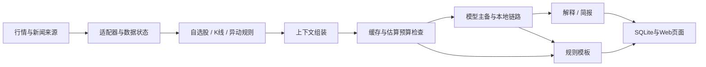

# AlphaProject · A 股行情与 AI 分析助手

面向个人学习与本地演示的 AI 应用工程项目：查看自选股行情、历史 K 线、异动事件，并使用模型生成解释和本地盘前简报。**没有券商下单、策略回测、实盘收益或真实持仓接入。**

## 来源与改动范围

基于 [FuFan-VibeCodingCourse](https://github.com/fufankeji/FuFan-VibeCodingCourse) 阶段八第 16 课 AlphaProject，基线提交 `5336ede159a7ac2ce0ee136324fe5bffd56970ca`。上游已提供主要业务结构、页面、规则、测试和模型降级框架。本仓库记录 Windows 部署适配、接口联调修复与 DeepSeek 接入实践，使用 AI 编程工具辅助；不将上游实现或 AI 生成代码等同于个人独立手写成果。

本地版本的增量包括：SQLite 连接释放、行情/新闻/简报字段适配、普通涨跌被误标为涨跌停的修复、DeepSeek 调用参数与超时控制、盘前简报成本记账、Windows 本地服务入口。

详见 [改动与证据](docs/CONTRIBUTIONS.md)、[测试范围](docs/VERIFICATION.md)。文件差异只能证明版本变化，不能单独证明作者或独立掌握程度。

## 技术与链路

FastAPI / Python · React / TypeScript / Vite · SQLite · AKShare / 腾讯行情 · OpenAI-compatible API



预算是基于 token 单价估计的软阈值；请求前检查不能保证并发下绝对不超支。主备/本地链路有代码不代表每个供应商都已真实验证。

## 本地运行

要求 Python 3.11 或 3.12、Node.js 20+、npm。以下命令在仓库根目录的 PowerShell 执行。

```powershell
Copy-Item .env.example .env
py -3.12 -m venv backend/.venv
& backend/.venv/Scripts/python.exe -m pip install uv
Push-Location backend
& .venv/Scripts/python.exe -m uv sync --frozen
Pop-Location
Push-Location frontend
npm ci
npm run build
Pop-Location
& backend/.venv/Scripts/python.exe -m uvicorn app.local:app --app-dir backend --host 127.0.0.1 --port 8000
```

打开 `http://127.0.0.1:8000`。不填模型密钥时为模板模式，真实行情仍依赖外网；不要将模板输出当成模型成功。密钥只填本地 `.env`。示例单价来自本地验证配置，需按服务商当前计费维护；历史模型名称也不保证未来可用。

```powershell
Push-Location backend
& .venv/Scripts/python.exe -m pytest -q
Pop-Location
Push-Location frontend
npm test
Pop-Location
```

## 当前限制

- 默认只在本机回环地址运行；没有完成面向公网的认证、安全和并发验收。
- 个股公告、全球行情等存在缺失或未接入路径，页面不能把缺失数据当正常结果。
- 飞书目标群消息发送、真实开市时段定时任务尚无完整验收；本仓库不自动配置外部消息目标。
- 历史记录中的真实模型请求仅证明当时样本成功，不代表长期可用或分析正确。
- 测试数量包含上游测试，不是个人原创测试数量，也不衡量投资效果。

## 许可

上游根目录 README 声明 MIT License，当前取得的源码中未发现独立 LICENSE 文件。本仓库保留 [上游来源与许可声明](THIRD_PARTY_NOTICES.md)，不冒充原作者，也不替第三方素材授予额外许可。
