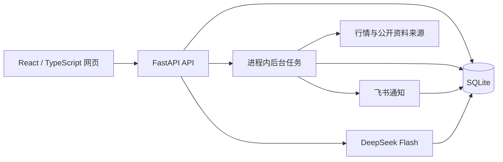

# AlphaProject · A 股行情与 AI 分析助手

AlphaProject 是面向个人使用的 A 股观察工具：在电脑和手机上查看同一份自选，核对行情与资讯的来源，接收异动提醒，并按需生成能回看依据的 AI 解释。

当前代码来自 **AlphaProject-Lab 统一版**，代码版本为 **v0.11.2**。它承接原 AlphaProject 的业务功能与历史档案，保留六个功能模块，并补充自选分组、持仓标记、综合资料和扩展提醒。原版已经退出活动运行；历史名称 `AlphaProject-Lab` 仍用于部分包名、服务名与脚本名。

- [代码仓库](https://github.com/vv510-ai/alphaproject-ai-research)
- [现有演示入口](https://8.155.130.86/)
- [产品需求](specs/prd.md) · [统一版实施方案](specs/016-unification/plan.md) · [统一版验收记录](specs/016-unification/acceptance.md)

项目用于行情观察、资料整理和 AI 辅助分析。没有券商账户接入、自动下单、策略回测或收益承诺；“持仓”是自选列表中的人工标记，不代表已同步真实证券账户。

## 功能

| 模块 | 可以做什么 | 行为边界 |
| --- | --- | --- |
| 自选管理 | 查询沪深证券、添加与移除自选、分组、持仓标记、排序、5 分钟内撤销删除；不同设备读取同一份数据 | 支持代码中列明的沪深 A 股前缀；撤销不会补发旧提醒，规则需重新核对开启 |
| 通知通道 | 飞书单人专用群、通道核验、测试发送、通知记录和收件确认 | 平台接受与本人确认分别保存；发送结果未知时不会自动反复重发 |
| 行情看板 | 报价、涨跌额/幅、日线、成交量、指数、全球行情、行业、资讯、公告及事件日历 | 展示来源时间与抓取时间；缺项、陈旧与失败明确呈现，不补造数值 |
| AI 解释 | 对已保存的异动事件或固定报价生成解释，引用冻结的资料，保存耗时、token 与预算记录 | 当前模型路由限定为 DeepSeek Flash；资料与价格同时出现不代表因果；结果需要人工核对 |
| 异动检测 | 相对昨收涨跌幅，以及涨跌停、历史收盘区间突破、量比、振幅、新资讯规则 | 先核对数据资格再触发；真实和演练模式分开，按证券/规则类型/日期去重 |
| 早盘简报 | 按设定时点生成非 AI 数据摘要，汇总自选与六类研究资料，并记录发送状态 | 现有时间选项为北京时间 08:45、09:00；手动生成只保存网页结果，不自动发送 |

统一版还提供只读的旧版历史档案。迁移不会把旧平台回执升级为“本人已收到”，也不会重新投递旧的未发送队列。

## 设计重点

- **每条解释都能回到当时的依据。** 事件、报价、资讯 ID 和时间随解释保存，后来的行情或规则变化不会替换旧证据。
- **先保留记录，再处理外部调用。** 通知与 AI 请求有持久状态、请求去重、失败和未知结果，不以 HTTP 成功替代业务结果。
- **失败时仍能看到旧数据。** 来源异常不会把历史有效报价或资料抹掉，页面会显示旧值及失败原因。
- **一份活动数据库、一套发送任务。** 数据存于 SQLite；应用使用单 worker 和运行锁，防止同一数据库被多个业务进程重复执行。

## 技术与架构



| 部分 | 实际实现 |
| --- | --- |
| 后端 | Python 3.12、FastAPI、Pydantic、Uvicorn、HTTPX |
| 前端 | React 19、TypeScript、Vite、Lightweight Charts |
| 存储 | Python 自带 SQLite，包含自选、行情、资料快照、事件、解释、预算、通知和简报 |
| 后台任务 | 应用进程内的行情采集、研究资料采集、异动检测和简报线程；当前实现未使用 APScheduler |
| 凭据 | Windows 用户范围 DPAPI；Linux 使用 systemd credentials |
| 部署 | Nginx + systemd + 单 Uvicorn worker，版本化代码包与数据库分离 |
| 检查 | pytest、TypeScript 类型检查、Vite 构建、隔离浏览器流程 |

依赖以 [Python 锁文件](backend/requirements.lock.txt) 和 [前端锁文件](frontend/package-lock.json) 为准。部分早期调研提到 AKShare、APScheduler 等候选方案，不能据此视为当前运行依赖；当前研究资料提供器直接使用 HTTPX。

## 目录

```text
.
├── backend/
│   ├── app/
│   │   ├── main.py                   # API 与应用启动装配
│   │   ├── store.py                  # SQLite、自选与共享状态
│   │   ├── quote_*.py / daily*.py    # 报价、连续采集与日线
│   │   ├── research_*.py             # 行情、资讯、公告、日历与固定资料
│   │   ├── anomaly_*.py             # 基础异动规则与事件
│   │   ├── extended_*.py            # 扩展异动规则
│   │   ├── explanation_*.py         # AI 解释及证据核验
│   │   ├── briefing_*.py            # 早盘简报
│   │   ├── feishu*.py               # 飞书接口与凭据
│   │   └── legacy_archive.py        # 旧档案与预算承接
│   ├── tests/                      # 后端及部署工具检查
│   ├── requirements.in
│   └── requirements.lock.txt
├── frontend/
│   ├── src/                        # 页面、面板、图表与 API 客户端
│   ├── public/licenses/            # 图表组件第三方声明
│   ├── tests/                      # 界面及真实 API/SQLite 组合流程
│   ├── package.json
│   └── package-lock.json
├── scripts/                        # 本地启停、配置导入、采样与验收
├── deployment/cloud/               # 发布、备份、迁移与服务器验收工具
├── experiments/                    # 早期数据与存储实验
├── specs/                          # 需求、研究、实施和验收说明
├── LEARNINGS.md                     # 工程复盘与已发现的失败边界
└── pyproject.toml                  # pytest 配置
```

运行时生成的 `.runtime/`、Python 虚拟环境和前端依赖不属于源码。部分历史验收说明引用维护者本机证据或私有运行记录，公开仓库不包含生产数据库、凭据及完整业务回执。

## 环境要求

- Python **3.12**。项目已有记录使用 3.12.10，云端部署工具也按 Python 3.12 准备环境。
- Node.js **20.19+ 或 22.12+**，满足当前 Vite 锁文件要求；项目已有环境记录为 Node 24 / npm 11。
- Git、npm，以及可访问依赖源和行情来源的网络。
- 仅接入 AI 或飞书时才需要自行准备相应凭据；未配置时可以启动本地页面和使用行情、自选功能。

下列步骤用于**新克隆目录和独立本地数据**。维护者已经迁到云端的原工作目录可能包含 `.runtime/cloud-primary.json`；本地启动器会拒绝启动该目录，避免两地重复通知和计费。开发应另用独立克隆，不要删除这个保护标记来复用活动数据。

## 快速启动

### Windows / PowerShell

```powershell
git clone https://github.com/vv510-ai/alphaproject-ai-research.git AlphaProject-Lab
cd AlphaProject-Lab

# 首次准备：创建 .venv，安装锁定依赖，构建前端
powershell -NoProfile -ExecutionPolicy Bypass -File .\scripts\setup.ps1

# 启动并打开网页；默认端口 18765
.\.venv\Scripts\python.exe -X utf8 scripts\lab.py start --open
```

也可以依次双击 [准备开发环境.cmd](准备开发环境.cmd) 和 [启动共享自选.cmd](启动共享自选.cmd)。准备脚本使用 PATH 中的 `python` 和 `npm`，运行前用 `python --version` 核对 Python 版本。

打开 [本地页面](http://127.0.0.1:18765/)。启动器还会显示同一局域网的访问地址；电脑运行且网络可达时，手机可打开该地址读取同一份自选。

```powershell
# 查看、停止或重启，只管理此克隆目录启动的进程
.\.venv\Scripts\python.exe -X utf8 scripts\lab.py status
.\.venv\Scripts\python.exe -X utf8 scripts\lab.py stop
.\.venv\Scripts\python.exe -X utf8 scripts\lab.py restart

# 默认端口被占用时
.\.venv\Scripts\python.exe -X utf8 scripts\lab.py start --port 18766
```

停止服务不会删除数据库。关闭网页也不会停止后台服务。

### Linux / Bash

```bash
git clone https://github.com/vv510-ai/alphaproject-ai-research.git AlphaProject-Lab
cd AlphaProject-Lab

python3.12 -m venv .venv
.venv/bin/python -m pip install -r backend/requirements.lock.txt
npm --prefix frontend ci
npm --prefix frontend run build

# 前台运行，Ctrl+C 停止；仅绑定本机回环地址
.venv/bin/python -m uvicorn backend.app.main:app \
  --host 127.0.0.1 --port 18765 --workers 1 --no-proxy-headers
```

打开 [本地页面](http://127.0.0.1:18765/)。这条命令用于新克隆的本地运行，默认数据文件为 `.runtime/watchlist.sqlite3`。服务启动时会初始化数据库。

应用没有多用户账号和按用户隔离的数据空间。能够访问页面的人共享同一份自选与设置；本地启动器绑定 `0.0.0.0` 以支持局域网使用。若需要不同的访问范围，应在部署入口明确配置。

## 第一次使用

1. 输入六位股票代码，点击“查找股票”，核对名称后加入自选。
2. 获取报价，分别查看“来源时间”“接收时间”和数据状态。接收时间更新不等于行情刚刚产生。
3. 打开“日线与成交量”或综合资料面板，查看同一天的价格、单位、来源与缺项。
4. 按需要设置分组、持仓标记和顺序；刷新页面核对保存结果。
5. 配置飞书后，在通知面板核验接收目标，再显式发送测试；实际收到后再进行页面确认。
6. 设置并开启异动规则。需要解释时，从事件或固定报价进入 AI 解释，查看引用与预算，再自行核对内容。
7. 在早盘简报面板选择时间并保存；手动生成与自然定时发送分开记录。

真实规则需要有效且连续的行情证据；休市、过期报价、身份不符或资料缺失可能使规则暂停。演练数据用于检查流程，不会被标为真实市场触发。

## 配置

### 普通运行参数

| 参数 | 用途 | 默认或要求 |
| --- | --- | --- |
| `ALPHA_LAB_DB` | SQLite 文件路径 | `.runtime/watchlist.sqlite3` |
| `ALPHA_LAB_PORT` | 生成本地详情链接使用的端口 | `18765`；启动器会同步设置 |
| `ALPHA_LAB_PUBLIC_URL` | 公网完整入口与路径前缀 | 默认不设置；配置时须为符合校验的 HTTPS 地址 |
| `CREDENTIALS_DIRECTORY` | Linux/systemd 注入的服务凭据目录 | 公网启动要求 AI 和飞书配置均就绪 |
| `ALPHA_UI_PYTHON` | 浏览器回归使用的 Python | 测试默认 `.venv/Scripts/python.exe`；Linux 需覆盖 |
| `ALPHA_UI_PLAYWRIGHT_MODULE` | 浏览器回归所用 Playwright 模块文件 | 可指定外部已安装模块的绝对路径 |

应用不会自动把任意 `.env` 文件加载成环境变量。数据库路径可通过 shell 环境变量设置；模型和飞书使用下面的专用配置机制。

### AI 配置

当前 [配置校验](backend/app/ai_config.py) 固定允许 `https://api.deepseek.com/v1` 与 `deepseek-flash`。仅更换环境变量或模型名不能接入其他供应商，改接时还需调整实现与验证。

配置包括 `api_key`、`base_url`、`model`、`daily_budget`、`monthly_budget`、`imported_at`。日/月预算必须明确设置，月预算不小于日预算。页面保存的是程序估算与预算账本，实际费用以服务商账单为准。

Windows 的 [AI 导入脚本](scripts/import_ai.py) 使用 DPAPI 保存到 `.runtime/ai-config.dpapi`。该脚本最初用于旧版迁移，读取 `项目父目录/AlphaProject/.env` 中的三个字段：

```dotenv
LLM_PRIMARY_BASE_URL=https://api.deepseek.com/v1
LLM_PRIMARY_MODEL=deepseek-flash
LLM_PRIMARY_API_KEY=
```

导入路径是现有代码的固定约定，脚本暂不接受 `--source` 参数。按上面的 `AlphaProject-Lab` 目录名克隆时，可在它旁边单独准备 `AlphaProject/.env` 作为私有配置来源，无需安装或启动旧版应用。不要为了导入而使用维护者的旧凭据。填好自己的密钥后可运行：

```powershell
# 示例预算，可按自己的实际预算修改；导入不调用模型
.\.venv\Scripts\python.exe -X utf8 scripts\import_ai.py --daily-budget 1 --monthly-budget 10
```

### 飞书配置

[飞书导入脚本](scripts/import_feishu.py) 同样读取 `项目父目录/AlphaProject/.env`，只选择下列字段：

```dotenv
LARK_APP_ID=
LARK_APP_SECRET=
LARK_RECEIVE_ID=
LARK_RECEIVE_ID_TYPE=chat_id
```

需要准备包含**一名群主成员和该机器人**的专用群，以及能完成目标核验和发送消息的应用权限。脚本实际查询并核验目标后，将配置加密保存到 `.runtime/feishu-config.dpapi`；导入本身不会发送测试消息。

```powershell
.\.venv\Scripts\python.exe -X utf8 scripts\import_feishu.py
```

重启本地服务后，在页面查看状态。不要把完整凭据、真实群 ID 或包含个人数据的错误记录贴到公开 Issue。

### Linux 凭据

Linux 不能直接解密 Windows 的 DPAPI 文件。当前服务通过 systemd 的 `LoadCredential` 提供 `ai.json` 和 `feishu.json`，并校验文件类型和权限；字段结构分别见 [AIConfig](backend/app/ai_config.py) 与 [FeishuConfig](backend/app/feishu_config.py)。服务文件示例见 [service.conf](deployment/cloud/service.conf)。凭据应保存在代码目录以外，不能提交进 Git。

## 开发与检查

以下命令在仓库根目录执行：

```powershell
# Windows：依赖一致性与后端检查
.\.venv\Scripts\python.exe -m pip check
.\.venv\Scripts\python.exe -X utf8 -m pytest -q

# 前端类型检查和生产构建
npm.cmd --prefix frontend run check
npm.cmd --prefix frontend run build

# 可选开发热更新：保持后端在 18765
npm.cmd --prefix frontend run dev
```

Linux 将 `.venv\Scripts\python.exe` 换为 `.venv/bin/python`、`npm.cmd` 换为 `npm`。Vite 开发入口默认 [5173](http://127.0.0.1:5173/)，`/api` 转发到 `127.0.0.1:18765`；跨设备体验应使用构建后的应用入口。

浏览器组合流程在 [persistent-flow.mjs](frontend/tests/persistent-flow.mjs) 和 [unified-flow.mjs](frontend/tests/unified-flow.mjs)。它们连接真实应用、API 与临时 SQLite，并检查刷新和进程重启；外部行情、AI 和飞书输入使用受控替身，不代表真实市场或真实送达。

当前前端锁文件未包含 Playwright。运行这些脚本前，需额外准备 Playwright 和匹配的 Chromium，通过 `ALPHA_UI_PLAYWRIGHT_MODULE` 指向该模块；Linux 还需设置 `ALPHA_UI_PYTHON`。不要将缺少这套额外环境误判为业务逻辑失败。

```powershell
# 配好上述浏览器环境后，在根目录运行
node frontend/tests/persistent-flow.mjs
node frontend/tests/unified-flow.mjs
```

2026-10-23 源码上传前，在排除运行目录、凭据及私有历史发布包的独立副本中，后端检查得到 **849 passed、19 skipped**；前端完成 `npm ci`、TypeScript 检查和生产构建。19 项跳过包括 8 项 Windows 平台/权限相关检查，以及 11 项依赖旧版发布归档的兼容检查。后端使用维护者已有的 Python 3.12 虚拟环境，未据此声明完成全新 Python 环境安装验证。

统一版的真实浏览器、历史发布兼容与线上流程记录见对应 [验收文档](specs/016-unification/acceptance.md)。上述上传检查没有重跑真实行情、AI、飞书或生产站点业务流程，也不代表这些外部能力在任意环境可用。

## 部署与备份

详细流程见 [云端部署说明](deployment/cloud/README.md)。现有工具包含纯代码包构建与哈希校验、服务器准备、数据库副本预检、备份、版本切换和公网复验。

`deployment/cloud/deploy.py` 是**现有站点专用工具**：服务器地址、SSH 工具位置、私钥目录、服务路径和 `/lab/` 前缀有固定约定。它不能直接作为任意服务器的一键安装器。部署自己的实例前应逐项替换并核对这些配置；不要直接运行维护者的 `seed`、`update` 或迁移命令。

部署时保留以下结构：

- Nginx 负责 HTTPS 与路由，Uvicorn 仅监听本机回环地址。
- 一个 worker 服务一份活动 SQLite，确保只有一套通知和计费任务。
- 数据与凭据存于发布目录之外；更新代码不上传本地数据库或配置。
- 回退切换代码，并先验证当前数据库兼容性；不要用旧备份覆盖更新后产生的数据。
- 备份工具使用 SQLite 一致性备份、完整性/外键与哈希检查。当前运维方案为同机备份，不等于异地灾难恢复。

本地数据默认为 `.runtime/watchlist.sqlite3`。复制本地库前停止服务，或使用 SQLite 一致性备份工具；保留所需的凭据恢复方案。不要通过删除数据库来修复启动问题。

## 常见问题

| 现象 | 排查方式 |
| --- | --- |
| 页面显示“尚未构建” | 运行 `npm --prefix frontend ci` 与 `npm --prefix frontend run build`，再启动后端 |
| 端口被占用 | 查看已有进程；本地启动器可加 `--port 18766`，不会替你停止其他程序 |
| 已迁云目录拒绝本地启动 | 使用新的独立克隆；保留 `.runtime/cloud-primary.json` 及原数据 |
| 行情未更新或标为旧数据 | 核对来源日期与交易时间；来源失败或休市时可能仍展示最后有效值 |
| AI 或飞书未配置 | 按专用导入/服务凭据流程准备，重启后检查页面状态；普通 `.env` 不会被应用自动加载 |
| Windows 加密配置无法读取 | DPAPI 文件绑定原 Windows 用户；新用户、新机器或 Linux 需重新配置 |
| 公网模式启动失败 | `ALPHA_LAB_PUBLIC_URL` 设置后会要求两类凭据齐全，先检查路径、字段、权限和实际部署入口 |
| 手机无法访问局域网地址 | 确认电脑服务仍运行、设备在同一网络，核对新 IP、防火墙与网络隔离情况 |

## 已知边界

- 交易日历目前只覆盖已经写入并核验的 **2026 年**；其他年份返回未知状态，不按星期数猜测。需要维护年度日历和临时休市信息。
- 公开数据来源可能不可用、限流、延迟或变更接口；页面保留来源与状态，无法保证持续实时。
- 统一版的自然盘中采集、各类规则自然触发、扩展资料简报首次自然生成、手机实机和本人确认，仍应按对应验收记录逐项核对。
- 没有多用户权限隔离、账户级持仓或交易执行；不适合直接当作多人托管服务。
- 配置导入与云端发布仍有原工作目录约定；浏览器测试需额外准备环境。

## 项目来源与文档

本项目沿课程的 A 股行情与 AI 分析助手方向开展实践，统一版保留从需求、研究、实现到验收的过程记录。代码实现使用了 AI 辅助开发；工程交付记录与学习者本人已独立掌握的能力分别记录。

- [精简 PRD 与六功能范围](specs/prd.md)
- [实现方案与技术选择](specs/research/04-实现方案.md)
- [开源项目研究](specs/research/03-开源项目.md)
- [两版统一的研究与来源](specs/research/06-GitHub学习与两版统一.md)
- [完整流程验收](specs/008-integration-acceptance/acceptance.md)
- [持续采集验收](specs/014-live-monitor/acceptance.md)
- [备份与服务器验收](specs/015-operations/acceptance.md)
- [统一版实施与交接](specs/016-unification/acceptance.md)
- [工程复盘](LEARNINGS.md)
- [原课堂进度记录](docs/learning-progress-20261023.md)（上传前原 README 的完整保留，历史路径按原记录理解）
- [来源与许可记录](THIRD_PARTY_NOTICES.md)

早期课堂材料与旧版应用是独立来源，未作为活动应用重复启动。研究资料提供器在文件头记录了对旧项目字段知识的参考；研究中出现的第三方项目不等于已整体安装或复制到本应用。

## 公开内容与许可证

仓库保留完整核心应用源码、依赖锁文件、测试和必要说明；旧版代码保留在 [legacy/pre-unification-20261023 分支](https://github.com/vv510-ai/alphaproject-ai-research/tree/legacy/pre-unification-20261023)。源码上传不包含 `.env`、API 密钥、SSH 私钥、DPAPI 凭据、生产 SQLite、日志、备份、虚拟环境、`node_modules` 或生产业务回执。`evidence/` 是运行验收材料与第三方调研缓存，也不随公开源码上传；因此部分历史规格中的私有证据链接在公开仓库不可访问。请保留这些排除项，提交前查看待提交文件。

当前项目尚未声明统一的顶层开源许可证；不要仅因仓库可公开访问就标注为 MIT 或 Apache-2.0。第三方组件适用其各自许可证，Lightweight Charts 与 Fancy Canvas 的已有声明位于 [third-party-notices.txt](frontend/public/licenses/third-party-notices.txt)，图表署名也需保留。课程资料及旧版代码的来源与许可范围应分别核对。
