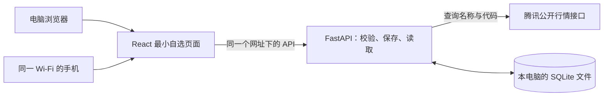

# 第八课：先跑通共享自选

日期：2026-10-17。对应 [PRD](../prd.md) 的 FR-001、AC-001/002。用户已要求完成必要架构、最小页面、独立开发环境，以及电脑添加、保存、重启和手机读取。此文为实施方案，实际结果另记在 [acceptance.md](acceptance.md)。

## 一条路径，三部分职责

页面是“操作台”，后端是“办理窗口”，数据库是“保存记录的本子”。手机不会另存一份自选。后端返回保存成功之后，页面才显示已添加；重启程序只重新打开数据库，不重新初始化用户列表。

沿用前面比较过的 FastAPI + React/TypeScript/Vite + SQLite。此课只实现一个应用服务进程，不启动定时器、模型或通知。页面构建后由同一后端提供，手机使用一个地址即可。开发时可另开 Vite 热更新，API 仍指向同一后端。

## 最小页面

桌面：页首显示应用名、连接状态和刷新按钮；主区域左侧是自选列表，右侧是“输入代码 → 核对名称/市场 → 加入自选”。手机按同样的阅读顺序排成一列。空列表有添加指引；断线保留上次读取结果并明确提示；移除采用行内确认。

本课展示代码、名称、市场和添加时间，不展示未接入的价格或虚构图表。列表定期重新读取，并在切回页面时刷新；以保存到后端的结果为准，浏览器存储不承担持久化。

## 数据与接口

| 项目 | 约定 |
| --- | --- |
| 数据位置 | 工程内 `.runtime/watchlist.sqlite3`，使用绝对路径定位；与当前终端所在目录无关；启动、重启和构建均不清空 |
| 唯一记录 | 市场 + 六位代码唯一；重复提交返回已有记录。名称由后端核对，不接受客户端自行填写名称 |
| 查找 | `GET /api/securities/{symbol}`：从公开来源核对代码和名称，返回市场、来源和核对时间。严格解析文本，不执行返回内容 |
| 读取 | `GET /api/watchlist`：只读本地数据库，第三方暂时断线不影响已有列表 |
| 保存 | `POST /api/watchlist`：重复项先直接返回；新项重新核对身份后，在短事务内写入；网络请求不占数据库写锁 |
| 移除 | `DELETE /api/watchlist/{market}/{symbol}`：只移除自选记录；重复移除安全返回，不操作其他数据 |
| 失败 | 错代码、来源暂不可用、保存失败分别给出可理解的信息；失败不显示成功、不用假名称替代 |
| 双设备 | 同一个局域网网址；电脑服务需要保持运行。实际手机访问须由用户完成，桌面移动视口不算实机验证 |

本课沿用报价实验中已经检查过的沪深代码前缀，查询成功才可添加；不据此声称覆盖所有证券。2026-10-17 重新取到 600519、000001 的代码/名称；这只证明本次身份查询，未验证盘中实时性，DATA-01 保留。

SQLite 每次操作打开独立连接，使用参数绑定、唯一约束、显式提交/回滚和有限锁等待；先保留默认回滚日志模式，不增加数据库服务。数据库忙或写入失败时返回明确错误，用户可重试。

## 开发环境与访问边界

- 在 Lab 新建 `.venv` 和 `frontend/node_modules`，不复制旁边应用的环境、配置或数据库。依赖锁定到实际安装版本。
- 当前使用 Python 3.12.10、SQLite 3.49.1、Node 24.15.0、npm 11.12.1；独立安装、后端检查和前端构建已通过，版本与结果见验收记录。
- 启动入口提供本机及局域网地址；启动/停止只管理本工程的进程，并核对进程身份，避免误停其他应用。后台运行不弹出额外服务窗口。
- 此阶段限本机/同一局域网使用。没有公网映射或账号体系；允许列表中的本机地址访问，修改请求检查来源和专用请求头，防止其他网页悄悄代发。局域网可到达此入口的人能操作同一份自选，属于当前练习边界。
- 防火墙仅在实际阻断时处理；先核验具体端口和当前网络，不关闭系统防火墙。若 Wi-Fi 开启客户端隔离，需要另选可互访网络。

## 检查与参与方式

1. 真数据库检查重复写入、并发唯一约束、移除、重新打开与写锁失败；接口检查身份核对失败、无效输入和请求来源边界。
2. 运行真实前后端，电脑页面添加示例股票，再刷新；停止后重新启动，核对数据库文件和列表未变。
3. 在另一独立浏览器上下文读取同一个地址，验证服务共享；另检查窄屏、键盘和失败提示。独立浏览器仍不是实体手机。
4. 给用户实际局域网地址，由用户在同一 Wi-Fi 手机打开、读取并操作。用户反馈前，手机实机项保留待验证；遇到失败继续定位网络或页面问题。

用户本课参与：自己输入一只已支持的股票代码，核对名称后添加；重复添加一次，观察只有一条；在手机打开同一个入口查看。由助手演示并记录服务重启，必要时也可用“重启共享自选”入口亲自操作。

## 直接参考与复用边界

- [FastAPI 入门](https://fastapi.tiangolo.com/tutorial/first-steps/)、[Uvicorn 配置](https://uvicorn.dev/settings/)：API 与服务启动。
- [Vite 入门](https://vite.dev/guide/)：当前 Node 要求与构建入口，本机 Node 满足文档版本条件。
- [Python sqlite3](https://docs.python.org/3.12/library/sqlite3.html)：连接、事务和参数绑定；[HTTPX 超时](https://www.python-httpx.org/advanced/timeouts/)：限定来源请求等待。
- 自有 [报价实验](../../experiments/02_fetch_spot.py)：借鉴身份校验与前缀处理，正式模块只提取本课需要的代码/名称，独立请求客户端，不复制临时 monkeypatch。

依赖来自 PyPI/npm 官方仓库，查询记录见 [版本记录](../../evidence/watchlist-20261017/package-sources.json)。不引入完整成品仓库。本课的实现、锁文件、实际操作记录一并保留，不能以“服务启动成功”代替保存/重启/手机流程通过。
