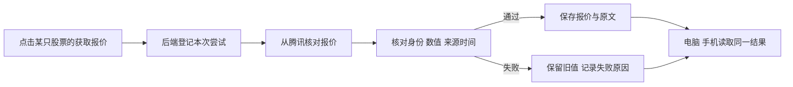

# 第九课：为共享自选接入最新可用报价

日期：2026-10-17。用户要求继续，沿第八课的下一步推进 FR-003 首页报价部分。本课完成逐只获取、来源与时间展示、旧值/错误处理、持久化及电脑/窄屏验证；日线图、盘中持续监测、异动、AI、通知和公网部署不在本课切片内。

状态：本切片已实现，实际执行与剩余边界见[验收记录](acceptance.md)。

## 这一课要看懂什么

**刚收到，不等于刚产生。**来源时间属于报价，接收时间属于我们的请求；更新页面不能把旧报价的来源时间改成现在。缺值不能补 0，来源坏数据也不能覆盖上一次核对过的报价。

## 实现取舍

- 在现有行下展示价格（元）、涨跌额/幅（相对同一来源昨收）、来源时间、接收时间和数据状态。保留已有自选管理；先逐只手动“获取报价”，后续可“更新报价”。
- 页面每 5 秒重新读取共享结果，只读数据库；打开多个页面不会自动增加向行情来源的请求。外部请求只由用户点击产生，每只股票两次请求至少间隔 30 秒，服务端记录后重启也保持。30 秒是本课防连点的保守设置，不是经核验的来源限频、监测周期 P 或有效期 F。
- 沿用已实验的腾讯接口与字段位置，并在本次重新实际请求。提取独立解析函数，使用 Decimal 核对价格、昨收、涨跌额与幅度；只解析响应，不执行来源文本。公开接口未见本工程可依赖的稳定协议或 SLA，字段变动时明确失败。
- 缺来源时间、身份错误、非有限数、零/负价格、算术不一致、未来时间或相对已有记录倒退的响应不替换已存值。旧日期可展示为“非今日报价”；同日也只写“实时性待验证”，显示具体时间及距今时长。交易日历与停牌尚未核实，不自行推断“休市/停牌”。
- P/F/Δ 等盘中参数仍待 DATA-01。本课拒用晚于本机接收时间的值是保守展示策略，不把它当成未来提醒参数已获确认。
- 只在现有数据库增加 `quote_cache`，保留现有自选表和版本兼容性；数据库提交/状态更新是短事务，网络请求在事务外。先备份当前数据库，在副本上检查旧记录和旧自选代码仍可工作。
- 刷新先登记尝试标识与时间，避免两个设备对同一条同时向来源请求；完成时核对该次标识以及自选创建时间。刷新期间移除或移除后重加，迟到结果不得恢复被删记录或写入新一轮自选。
- 前端显示迟到响应时也核对自选创建时间；操作错误与加载状态关联同一条记录。涨跌额严格等于价格减昨收，涨跌幅按十进制四舍五入到两位后核对，避免宽容差放过方向矛盾。
- 每份有效结果保留来源原文、解析值、来源/接收时间。当前只是“最新报价缓存”，不是不可改写的异动证据；未来事件需另存当时快照。

## 数据流与接口

`GET /api/dashboard` 读取自选及已保存的报价状态，原 `/api/watchlist` 保持原契约。`POST /api/quotes/{market}/{symbol}/refresh` 只查询已在自选中的股票，沿用同源修改检查；返回实际成功/失败状态，不能仅凭 HTTP 200 判定取数成功。日期判断统一按北京时间，所有保存时间带时区。

## 验证与用户参与

1. 用明确标注的合成报文检查正常、旧日期、缺时间、NaN、价格为零、身份错误、未来时间与倒退；比较失败前后的已保存值。
2. 真数据库检查刷新互斥、失败后重试、保存结果重开、处理中删除/重加、旧代码与新增表兼容；已有自选检查继续通过。
3. 真页面点击获取，核对原始响应 → 后端存储 → 页面价格与两个时间；重启后仍能读原报价，刷新失败不冒充更新。
4. 桌面与窄屏检查价格、时间、提示和按钮；由用户在页面点击并反馈所见的来源时间/状态。实机反馈与浏览器模拟分别记录。

## 直接参考

本工程[第三课报价实验](../../experiments/02_fetch_spot.py)提供已测字段与失败样本；沿用方法，保持原实验文件不改。

[Python Decimal](https://docs.python.org/3.12/library/decimal.html)用于十进制数值核对；[SQLite 外键](https://www.sqlite.org/foreignkeys.html)用于关联缓存的删除约束，需要每个连接启用；[HTTPX 超时](https://www.python-httpx.org/advanced/timeouts/)用于限制连接及读取等待。实际请求与失败证据存入本课 evidence 目录，完成后在验收记录中写明覆盖范围。
