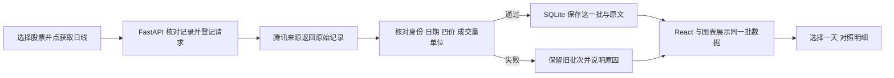

# 第十课：日线与成交量

日期：2026-10-18。用户明确要求接入日线和成交量，边开发边解释，并让用户实际操作。本课完成 FR-003 的历史走势部分；不提前开发其他功能或部署 Lab。

## 先讲清楚要看什么

本课用日 K 线画日线：每个交易日期有开盘、最高、最低、收盘四个价格。成交量是这一日成交的股票数量，统一显示为股。日线帮助看一段时间的变化，成交量提供交易活跃程度的背景；它们不能单独证明涨跌原因，也不是收益保证。

K 线颜色按收盘与开盘比较：高为红、低为绿、相等为灰。首页报价的涨跌幅按昨收比较，两者的基准不同。历史价格先采用已讨论的不复权口径：保留来源历史价格，分红送转等可能造成跳变，不把整段价格变化直接当作投资收益。

## 本课范围与实现

- 在自选行增加“日线与成交量”入口，下方展开所选股票的详情。上图日 K 线、下图成交量，共用日期轴；点击图或选择日期后，查看同一天的四价、成交股数、来源原量与单位换算。保留可读的逐日数据表，不能只有画布。
- 首次打开只读取已保存数据，点击“获取日线 / 更新日线”才查询来源。查询区间为北京时间昨天往前 180 个自然日，排除当日可能尚未结束的日线；不使用未核实交易日历猜最近交易日，不补造缺失交易日。
- 沿用已跑通的腾讯方向，实际接入 `newfqkline/get` 的不复权 `day` 数据。该响应额外提供成交额，能用于交叉检查成交量单位。此前独立实验通过 AKShare 调用；本课参考其参数/字段映射，使用已有 HTTPX 写受限适配器，运行环境不新增整套 AKShare/Pandas 依赖。原实验保留。
- 上游可能返回请求区间外记录，验证日期后显式筛选；只接受匹配股票键和身份、不复权字段、唯一日期、有限正价格、合理高低范围、非负且可换算为整数股的成交量。成交额按来源万元换算，检查其是否落在最低价×股数与最高价×股数之间，金额舍入容差 50 元。失败保留完整旧批次，不悄悄拼接另一口径。
- 2026-10-18 实测 `600519/000001/300750` 来源量为手、`688981` 为股；两种腾讯入口的样本原量一致，按对应系数换算后的成交均价均落在日内高低范围。它们是代表性样本，不是两家独立数据源，也不是全市场覆盖证明。逐批继续校验；未知单位不猜。
- SQLite 增加独立 `daily_cache` 表，不改变原自选、报价及版本标记；先备份并在副本检验旧代码。短事务登记刷新与写回，网络在事务外；30 秒防连点与请求标识跨重启保存。删除/重加后，旧请求不得写入或显示到新记录。
- 使用官方 npm 包 Lightweight Charts **5.2.1**，仅负责画图，数据由本工程提供。保留 Apache-2.0、NOTICE、TradingView 署名和链接；直接依赖 fancy-canvas **2.1.0** 的许可一并保留。

## 最小接口与状态

`GET /api/daily/{market}/{symbol}` 只读当前自选记录及缓存；`POST /api/daily/{market}/{symbol}/refresh` 提交请求时的自选创建时间，服务端核对后才取数。返回当前记录标识、报价批次、来源/接收时间、范围、单位与刷新状态；原文留在数据库，普通页面读取不传整段原文。失败与 HTTP 成功分开，客户端也核对记录标识并取消已经离开的页面请求。

## 检查与用户参与

1. 合成报文检查错代码/复权、重复/未来日期、缺值/NaN、四价矛盾、负成交量、单位相差百倍与实际零量；拒用时旧批次保持。
2. 数据库检查并发点击、删除重加、请求中断、重启保持与旧代码兼容；原 44 项相关检查继续通过。
3. 真页面取数：原始响应 → 已保存字段 → K 线/量柱 → 同一天明细及表格。实际停启再读；检查接口失败、桌面/窄屏、键盘和图表生命周期。
4. 请用户打开所选股票，选一天，反馈日期、收盘价和成交量单位。用户反馈、助手实测和浏览器手机模拟分别记载。

## 参考与仍待验证

- [AKShare 腾讯日线说明](https://akshare.akfamily.xyz/data/stock/stock.html#id22)：字段、复权概念与库输出单位；[固定提交源码](https://github.com/akfamily/akshare/blob/fe10d1decb705e5f43cc8ca3339ca39e580fb8f4/akshare/stock_feature/stock_hist_tx.py)用于核对协议映射。源码的 `sz000` 换算条件仍需用样本反证，不能照抄。
- [Lightweight Charts 官方用法与署名](https://tradingview.github.io/lightweight-charts/docs)、[双图区域](https://tradingview.github.io/lightweight-charts/tutorials/how_to/panes)。只采用有效 API，示例数据不进入产品。
- 具体来源探测与单位检查见 [evidence](../../evidence/daily-20261018/source-probes.json)及[单位核对](../../evidence/daily-20261018/volume-unit-verification.json)。来源稳定协议、使用条件、全代码覆盖和交易状态仍待核验。
- DATA-01 盘中验证继续待办。本课历史数据不为异动触发提供已验证的实时性；历史行情缓存也不代替未来事件的固定证据快照。

状态：页面、接口、保存与本课检查已完成，用户已提供实际页面截图；覆盖范围与未验证条件见[验收和操作记录](acceptance.md)。范围按钮按可重复执行的操作实现，并与选中日期一起回到最新一天；画布范围和十字线由同一次更新处理。
