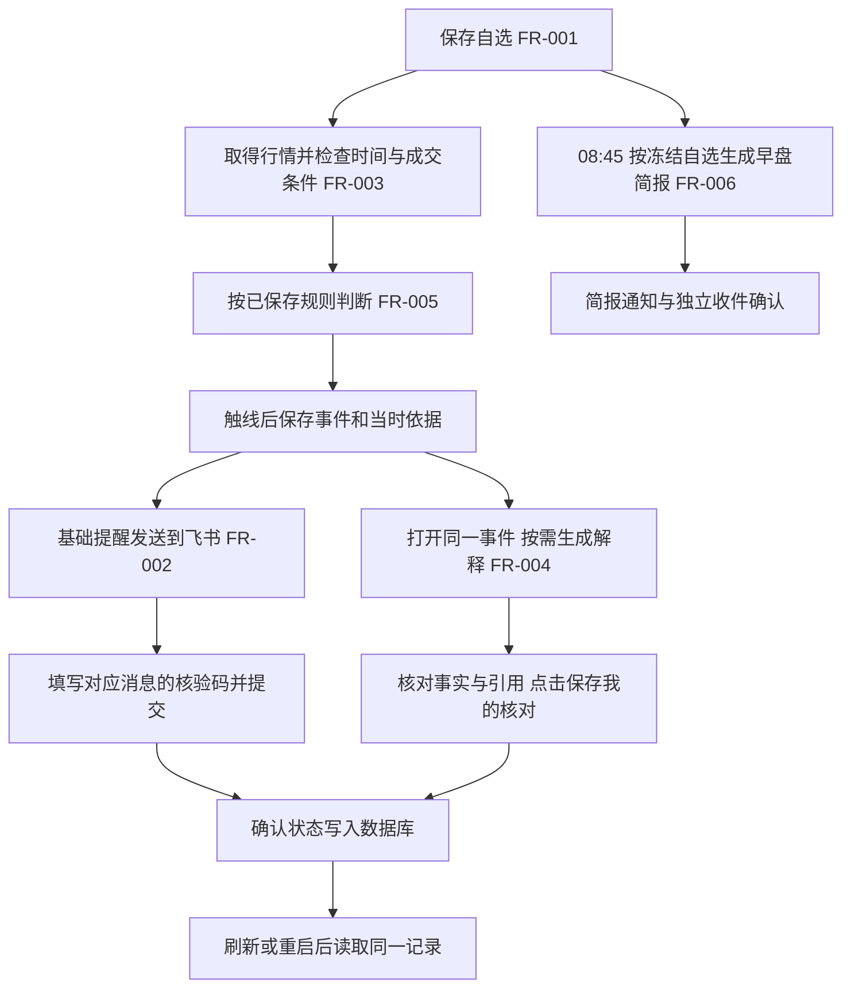

# 第十五课：六个功能怎样算真正接通

本文件前半部分保留第十五课当时的状态；当前补充见末尾[第二十三课](#第二十三课真实浏览器连接与历史证据修复)。旧局域网地址与“监测暂停”等表述只适用于对应历史时点。

日期：2026-10-19。范围为本地 AlphaProject-Lab，沿用六项 FR 与 13 条 AC；本课做联调和必要修复，不发布到原生产网站。

**当前结论：内部六模块接力、受控失败和重启保存已通过；本课真实用户操作仍进行中，不能宣布六项需求全部验收完成。** 实际程序保持 0.7.0，本课新增完整流程测试和验收记录，未改应用代码。

## 本课检查顺序

1. **自选 → 两端共享 → 行情**：用户在电脑添加联调样本 000001，手机读取同一份列表；核对股票身份、报价来源时间及日线单位。记录本课新增项，结束后只移出这个测试自选，保留原 600519。
2. **规则 → 合成事件 → 飞书**：由用户在页面触发一次明确标注的下跌演练。跟踪同一个事件编号、价格和阈值；收到后由用户填写消息中的核验码。助手不代写本人确认。
3. **同一事件 → AI 解释 → 人工核对**：沿用已批准的 DeepSeek 配置和每日 1 元/月 10 元预算；按需生成，逐项核对同一事件的事实、引用和缺失材料，由用户保存人工核对。
4. **同一份自选 → 早盘摘要**：核对既有真实摘要的固定清单及日期，新增/删除自选不改写旧摘要；定时入口在隔离环境使用合成时钟检查，不能只调用生成函数。
5. **失败、重复、刷新与重启**：用受控失败检验 AI 等待/失败不阻挡基础通知；相同请求不会多生成或多发送；完整运行后刷新并重启，核对记录和费用保留。

## 判断整个系统跑通的标准

不能只看按钮成功、接口 200 或测试数量。每条主线都要有同一个对象的证据：股票代码、清单记录、事件编号、解释依据及消息关联必须对得上；价格、日期、单位与页面一致；最终结果重新读取仍存在；失败有准确状态且不造成错误或重复副作用。

“程序生成”“平台接收”“用户实收/核对”分别记录。外部替身只证明内部交接和受控失败，不证明真实外部服务可用；浏览器模拟窄屏不等于手机实机。用户反馈与服务器记录不一致时保留两者并定位，不代替用户写入确认。

## 当前已知边界

- 实际运行版本从 0.7.0 开始，基线为[初始快照](../../evidence/integration-20261019/input-snapshot.json)。本课开始时有 1 只自选、1 条旧合成事件、2 条真实 AI 调用记录、3 条旧飞书记录和 1 份真实数据简报。
- DATA-01 仍未完成，真实盘中监测暂停。本课演练可验证规则、记录、通知和解释的连接，不证明真实市场连续监测。
- 简报自然 08:45 的真实投递尚未验证；本课不修改电脑时钟、不改变既有约定时间来伪造自然运行。
- 旧飞书收件和 AI 人工核对有用户反馈但此前服务器时间为空，本课通过实际操作重新核对保存路径，不把旧反馈直接覆盖成服务器事实。
- 目前进行中：核对用户反馈与实际服务的差异。用户反馈已完成添加/手机查看、演练及收件，但回读时尚无相应保存记录；助手随后示范将 `000001` 加入当前学习版，来源首次失败、重试成功，添加时间为 22:57。新演练和收件仍未在本服务出现。详见下方实际操作记录。

## 为什么这些检查值得做

| 要检查的事情 | 用户可能遇到的问题 | 怎样才算通过 |
| --- | --- | --- |
| 同一条记录接力 | 各页面都能打开，却说的不是同一只股票或同一次变化 | 自选身份、事件编号、通知关联、解释依据及数值一致 |
| 来源时间与单位 | 把刚收到的旧行情当成新行情，把“手”误当“股” | 原日期、来源时间、收盘价与换算可直接复算；旧值标旧值 |
| AI 慢与失败 | 解释接口拖住了本来应先发出的提醒 | 模型仍等待时，基础通知和简报已完成各自处理；模型失败不删除原事件 |
| 重复与结果未知 | 用户网络慢、多点几次，产生重复消息或费用 | 相同请求回读原记录；只有显式重试才新增模型调用，旧失败保留 |
| 确认、删除、重启 | 页面一时显示成功，刷新丢失；移出自选误删历史 | 保存后 GET 可读，重建应用后时间与内容不变；删除仅影响当前关注项 |

产品判断是：基础提醒独立于 AI，事实在发生时保存，取消关注不抹掉历史；只有最终结果能回读，才把一次操作记为完成。

## 本课已经执行的联调

[完整流程测试](../../backend/tests/test_integration_flow.py)从公共 API 开始，使用实际 SQLite、应用启动时注册的异动后台和简报调度，经过以下过程：

`添加自选 → 获取报价/日线 → 保存规则 → 下跌合成事件 → 基础通知 → 同事件 AI → 收件/人工核对 → 定时简报 → 移出自选 → 重建应用再读`

外部股票来源、模型与飞书替换为可控制的接口；内部的规则、入队、调度、存储、预算和确认没有替换。AI 故意保持等待，跨过合成时钟的 08:45 后，基础提醒和简报分别进入平台接收状态；此时 AI 仍在等待。随后让模型失败，显式重试成功，复用结果不新增调用。最后比较相同事件、依据、消息正文和费用。这里的“接收”来自假飞书，不能写成真实送达。

测试还从对应假消息正文提取核验码，经实际确认 API 保存，并在重建应用后比较同一消息的确认时间。AI 三项人工核对在该测试中也是合成操作，不代表用户本人已经核对。

- 作者运行：[1 项完整流程通过，5.60 秒](../../evidence/integration-20261019/tests-six-flow.txt)。这 1 项内含多个跨模块断言。
- 独立复跑同一测试：1 项通过，5.45 秒；另用独立探针检查错码、少勾一项被拒、正确确认保存、保留原 `600519` 和旧简报，详见[复核记录](../../evidence/integration-20261019/review-resolution.json)。
- 已有 [248 项检查](../../evidence/morning-briefing-20261019/tests-final.txt)对应的应用源码哈希未变，继续作为下层证据；没有把两次分别运行包装成“本轮全套 249 项已重跑”。
- [真实页面回读](../../evidence/integration-20261019/browser-readback.json)：旧 `600519` 事件、通知及真实模型结果指向同一事件，`103 / 100 / 3%` 和依据摘要一致；只读取已保存结果，没有新增真实模型或消息调用。
- [当前只读核验](../../evidence/integration-20261019/verification.json)：检查运行版本、网页构建、原始记录、源码/课程材料及原生产工作区。后续用户操作完成后再补本课新链路的实际重启。

浏览器检查发现图标请求 `/favicon.ico` 为 404，以及部分已有、带 label 的表单控件缺少 id/name 的提示；核心页面与 API 正常，未将这两项记为阻断故障，也不声称控制台完全无提示。

## 实际页面操作与待定位差异

用户于 22:56 反馈“手机已看到 000001 平安银行”，但 22:56 的后台回读仍只有原 `600519`。助手没有据此写成跨设备通过，而是在当前网页示范添加：首次保存遇到行情来源暂时不可用，提示失败且未写记录；重试后于 **22:57:25** 保存 `sz000001`，当前共 2 只自选，原 `600519` 未变。

随后助手通过实际页面获取了 `000001` 的报价和日线：

| 项目 | 当前保存的数据 | 如何判断 |
| --- | --- | --- |
| 报价 | 11.65 元；昨收 11.50 元；+1.30% | 来源时间 10 月 19 日 16:15，接收时间 22:58；显示“今日报价 · 实时性待验证”，不当成 22:58 刚成交 |
| 日线 | 最新 10 月 16 日；收盘 11.50 元；共 119 条 | 对应报价里的同一来源昨收，日期与页面选择一致；本轮只画昨日及以前的日线 |
| 成交量 | 1,111,851.00 手 × 100 = 111,185,100 股 | 原量、倍数和目标单位都可核对；实际表格和图已生成 |
| 旧早盘简报 | 仍只含冻结时的贵州茅台，收盘 1329.00 元 | 增加平安银行没有改写旧摘要，接口提示自选清单已变化 |

[数据记录](../../evidence/integration-20261019/actual-market-readback.json)保留身份、原量及旧简报；[用户参与记录](../../evidence/integration-20261019/user-participation.json)分别保存用户反馈与服务观察。

用户于 22:58 反馈“三步演练完成，已收到飞书并在网页保存核验码”。到 **23:00:51**，本服务的 `000001` 规则仍为空，演练列表仅有前课 `600519` 上涨记录，通知仍为前课 3 条，确认时间为空。原因目前未知，不能断言用户没有操作，也不能把反馈记成已在当前服务保存。已请用户提供手机地址栏完整地址、股票代码和事件编号末 8 位来定位，暂不再次演练或补发消息。

这次差异本身就是验收发现：**口头反馈、页面名称和持久记录没有对应上时，结论保持待核对，先找同一个对象。** 当前测试自选保留供继续定位；本课结束时只移出本次添加项。

## 六项功能与 13 条验收怎样对应

| 功能 / 验收 | 当前有的直接证据 | 仍需区分或完成 |
| --- | --- | --- |
| 自选 FR-001，AC-001/002 | 公共 API 保存、重复添加、删除和重启回读；助手实际添加 `000001`，原数据保留 | 用户反馈手机看到早于本服务新增，地址/记录对应关系待定位；模拟环境不代替手机 |
| 通知 FR-002，AC-003/004 | 同事件消息关联、发送状态、假码保存重启；前课有真实平台回执 | 本人实收确认仍未落库；本节时点尚无直达链接，后续第十六课已补，手机飞书内点击仍待验（ENTRY-01） |
| 行情 FR-003，AC-005/006 | 真实 `000001` 报价、119 条日线、原量换算和图表；原股票旧值标旧；来源失败未假报保存 | DATA-01 未完成，不能把历史取数或演练当连续实时行情 |
| AI FR-004，AC-007/008 | 同事件依据、慢/失败不阻塞、重试与费用保留；旧真实输出可回读 | 本人核对仍未落库；本节时点无事件股票解释未实现，后续第十六课已补并有真实模型结果（AI-DETAIL-01） |
| 异动 FR-005，AC-009/010 | 后台真实消费合成输入，触线创建、持续满足不重复，删除保留历史 | 真实行情监测仍暂停；合成输入只证明算法与连接 |
| 简报 FR-006，AC-011/012 | 注册调度、同自选摘要、AI 等待时仍完成；旧真实摘要与设置保留 | 自然 08:45 真实投递与本人实收尚未验证，不修改系统时钟代替 |
| 跨模块 AC-013 | 公共 API 全链路与独立探针通过；旧真实事件、平台回执和模型依据一致 | 本课新真实演练、本人实收与本人 AI 核对还要操作；不宣称实际外部 AI 超时组合已验 |

## 用户已暂缓的操作

用户随后明确说“我先不发 继续开发”，因此手机地址与事件编号核对暂缓，不要求现在回答。下列步骤仅作为以后恢复时的参考。后续[第十六课](../009-evidence-entry/acceptance.md)已补齐本节当时发现的两个入口，完成真实报价解释并移出临时 `000001`，历史依据保留。

1. 电脑打开[本次局域网入口](http://10.234.92.38:18765/)，输入 `000001`，点“查找股票”。核对“平安银行 · 深市 A 股”，再点“加入自选”。查到身份不等于已经保存。
2. 手机连同一 Wi-Fi，打开同一地址并刷新，查看是否有同一只股票。没有手机时如实记“仅电脑”，不会用模拟浏览器冒充手机。
3. 在该测试股票上保存上下各 3% 的演练规则，真实规则保持关闭；由用户选择一次下跌演练并明确勾选发送，核对 `97.01 → 97 → 96.80`，然后在飞书核对事件编号并回网页填写该消息的码。
4. 对同一事件生成解释，核对价格、方向、引用与缺少的原因材料，再由用户保存三项核对。助手回读持久状态，不代用户勾选。
5. 检查已有简报冻结清单；只移出本课新增的 `000001`，保留原 `600519`。空闲时重启本地服务，对照历史事件、解释、确认时间和费用。

后续实际消息与模型调用沿用已批准的专用群及每日 1 元/月 10 元预算；本课当前未因等待用户操作而主动新增调用。用户操作尚未完成的项保持待验，不把“下一课”当作自动批准全部验收。

## 第二十三课：真实浏览器连接与历史证据修复

2026-10-22。用户要求把开盘验收交给服务器，继续做不依赖交易时段的剩余工作。本轮对应课堂笔记一 10.7–10.9 的真实联调、缺陷修复，以及 11.2 的经验收尾；六项 FR 和 13 条 AC 保持原范围。

**当前结果：真实事件解释断点已修复，新增 17 项后端回归和 20 项实际浏览器检查通过；v0.10.3 已于 2026-10-22 04:38 发布并完成公网、历史与原定任务复验。** 自然盘中、本人确认与手机实机仍分别待验。

### 修复了什么

已有合成事件可以解释，但实际采集产生的 `live` 事件在解释入口丢失 `eligibility`，导致所有合格的真实事件也返回 HTTP 422。此次先由两次受控原始行情经实际解析、采集、资格与事件服务产生记录，再由浏览器访问实际接口，复现了该问题；[修复前接口记录](../../evidence/persistent-flow-20261022/browser-before-fix.json)保留了失败证据。

修复后传入并复核原事件的资格，绑定**原保存时刻和原自选记录标识**。缺失、伪造、身份/数值/时间不一致、没有成交量增长、错时段及错自选代次仍在调用模型前被拒绝。后来改规则、更新报价、移出再加入自选、过一天或重启，都不能替换历史依据。展示文案改为“缺少可比较的成交量背景”，避免把用于确认近期成交的累计样本误当作涨跌原因分析；模型输入和提示词版本没有扩展，旧解释没有被改写。

### 用户主线与验证位置



基础提醒与按需 AI 分支独立。图表示代码中的用户路径，各段是否经过受控验证、真实平台验证或本人确认，以下表为准。

| 检查范围 | 本轮证据 | 能说明什么 / 不能说明什么 |
| --- | --- | --- |
| 合格 live 事件、上涨/下跌解释、坏证据拒绝、原依据保留 | [17 项后端回归](../../backend/tests/test_live_explanation_flow.py)；与旧解释、报价和六模块组合同跑 91 项通过 | 实际服务和 SQLite 路径通过；输入与模型受控，不是自然交易结果 |
| 页面提交、错误码、未保存草稿、显式重试、刷新、两次进程重启及移出自选 | [20 项浏览器结果](../../evidence/persistent-flow-20261022/browser-result.json)、[桌面通知](../../evidence/persistent-flow-20261022/notification-desktop.png)、[390 宽度依据页](../../evidence/persistent-flow-20261022/evidence-390.png) | 页面直接连接实际 API、服务和独立数据库，API 响应没有替换；外部行情、飞书和模型为替身。浏览器代做的合成确认不算用户本人确认 |
| 独立审查 | [审查记录](../../evidence/persistent-flow-20261022/review.md) | 关闭原代次空值绕过和测试时钟排序问题；另核验 10 种非法代次组合 |
| 全量检查与发布 | [本机检查](../../evidence/persistent-flow-20261022/build-tests.txt)、[Linux 检查](../../evidence/persistent-flow-20261022/server-tests.json)、[发布](../../evidence/persistent-flow-20261022/activation.json)、[最终核验](../../evidence/persistent-flow-20261022/result.json) | 本机 607 passed / 8 skipped；Linux 615 passed。数据库实际副本预检、备份和纯代码切换通过；公网前后端版本与包一致 |
| 自然时点与本人体验 | [服务器验收安排](../015-operations/acceptance.md)、本文件前半部分的用户反馈记录 | 仍由服务器观察自然盘中与 3% 触线；手机实机和本人确认继续保留待验 |

原有浏览器规则检查替换了全部 API，原六模块集成检查从 `TestClient` 调后端。两者仍有价值，本轮只补此前没有覆盖的页面到后端连接。已有历史实收差异的原因尚未确定；受控回归通过不能倒推此前用户使用了哪个地址或有没有点击保存。

线上版本为 `lab-20261021T203330782261Z`，源码 SHA-256 为 `19183771f625f0e916c13a977628c3f25236c30c8a89fd9283707bbd83fd0781`。[公网实际页面](../../evidence/persistent-flow-20261022/public-browser.json)能读取原合成事件及已有解释，未提交确认、生成或发送；已知根目录图标请求 404 仍存在，应用文件和读取接口正常。本轮没有新的自然 live 事件，因此新修复的 live 路径由同一源码的隔离浏览器与目标 Linux 回归证明，不能写成自然行情解释已实测。

发布前后 16 张业务表内容哈希一致，茅台涨跌各 3%、规则 v2 和开启状态保留；原站进程及版本保持不变。验收/备份的固定脚本、配置、排期、回执和通知账本均未改。应用切换时的 `daemon-reload` 清空了已退出验收命令在 `ExecStart` 中显示的临时 PID/开始结束时间；比较时保留这项原始差异，并独立核对实际命令、unit 文件哈希和已保存执行报告，未当作重新执行。本轮生产新增模型记录、飞书消息和代填本人确认均为 0。

### 怎样复跑这条检查

在本项目的 `frontend` 目录构建页面，再运行 [persistent-flow.mjs](../../frontend/tests/persistent-flow.mjs)。脚本调用[隔离启动器](../../backend/tests/browser_flow_fixture.py)，每次在 `.runtime/persistent-flow/<时间与随机标识>/` 建新库，仅监听 `127.0.0.1`，通过父进程标准输入控制停止/读回；应用没有新增测试接口。浏览器与 Python 的外部网络均被阻止。结果与截图保留，进程正常退出。

本机复用已安装的 `playwright-core` 和浏览器，不添加产品依赖；`ALPHA_UI_PLAYWRIGHT_MODULE` 指向其 `index.mjs`，`PLAYWRIGHT_BROWSERS_PATH` 指向已有浏览器缓存，必要时以 `ALPHA_UI_PYTHON` 指定项目解释器。Windows 执行环境须允许本机回环。

```powershell
npm.cmd run build
node tests/persistent-flow.mjs
```

浏览器先使用合成的合格 live 事件；第一次模型调用故意失败，明确重试后成功。逐步核对同一个事件、消息、解释和数据库记录，没有调用真实模型、发送真实飞书或写入生产的本人确认。

### 按课堂收尾

已把五条可复用经验写入 [LEARNINGS.md](../../LEARNINGS.md)，并在工程规则中加入按相关链路回看经验的入口。经验包含问题现象、下次做法及证据范围；不增加第七项功能、不用文档数量代替验收，也不把助手实现记作用户已经独立掌握。
