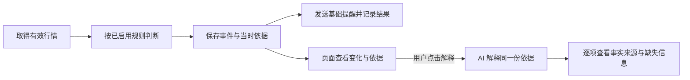

# AlphaProject-Lab 精简版 PRD

版本：v0.19｜日期：2026-10-23｜状态：统一版 v0.11.2 已上线，根网址接入、两库历史与预算承接、旧服务退役归档完成。最终服务器 868 项检查通过；实际公网 AI、原历史链接、公开访问和唯一业务进程已核验。新增能力的自然触发、首次自然简报和本人确认仍分别待验，详见 [统一版验收](016-unification/acceptance.md)。

本文件规定第一版应做到什么、怎样检查。六个功能和“能查依据的异动解释与提醒”已获用户确认；下文标为“建议”的细节尚未逐项确认。**FR-001 的共享列表和 FR-003 行情展示见[第八课](001-shared-watchlist/acceptance.md)、[第九课](002-watchlist-quotes/acceptance.md)和[第十课](003-daily-history/acceptance.md)；FR-002 通知见[第十一课](004-feishu-notifications/acceptance.md)；FR-005 规则、后台演练、固定事件与基础提醒见[第十二课](005-anomaly-detection/acceptance.md)。FR-004 事件解释见[第十三课](006-ai-explanation/acceptance.md)，FR-006 数据简报见[第十四课](007-morning-briefing/acceptance.md)。跨模块证据与待验项集中在[第十五课](008-integration-acceptance/acceptance.md)。[第十六课](009-evidence-entry/acceptance.md)补齐新消息/网页事件直达与无事件股票固定报价解释；真实飞书客户端新链接点击仍待验。局部通过不等于六功能全部通过。**

## 1. 给谁用，解决什么问题

给用户本人使用，电脑和手机查看同一份自选。首页先看到关注的股票；出现变化时，能查清“发生了什么、依据是什么、提醒处理到哪一步”，再按需查看 AI 解释。早盘简报汇总同一份自选，明确数据日期和缺失项。

**用户已确认的首版选择：**先在同一 Wi-Fi 下跑通；第十七课进一步选择现有阿里云独立公网入口 `https://8.155.130.86/lab/`；异动先做相对昨日收盘价的涨跌幅达到设定阈值提醒；异动与早盘简报发送到飞书里只有用户本人的专用群。第十一课复用原项目配置，已核对“量化推送”私有群的 1 位成员和机器人“vv小助手”，真实测试有平台回执，本人已反馈收到，网页核验尚未落库。第十二课用户另选教学演练上涨/下跌均为 3%，同股票同方向每日一次；此选择不等于已开启真实监测。第十三课选择沿用 DeepSeek，每日估算上限 1 元、每月 10 元。第十四课选择交易日北京时间 08:45 自动生成简报、按飞书开关发送；首版仅整理上一交易日收盘价、成交量与缺失项，不调用 AI。

第一版保留六个功能：自选管理、通知通道、行情看板、AI 解释、异动检测、早盘简报，分步交付。当前范围不包含下单、收益预测、全市场扫描、自然语言选股、多用户独立账户和全天候实时行情保证。

**已确认来源：**[项目约定](../AGENTS.md)、[05-决策汇总](research/05-决策汇总.md) D-01～D-06，以及用户 2026-10-17 本轮要求。用户本轮同意按[改进路线](learning/课堂路线改进建议.md)继续，明确优先做好可查依据的解释与提醒；不等于全部建议参数已确认。

## 2. 六个功能及统一版增量

2026-10-23 用户批准统一上线并停用旧版；保留原六个需求编号。以下增量已实现并验收，原核心行为继续适用：

- **FR-001：**增加分组管理、持仓标记、完整顺序和 5 分钟删除撤销；跨页版本冲突明确报错，撤销关闭规则并保留历史。
- **FR-002：**唯一业务发送者；原版通知只作档案，旧未投递不补发，旧成功不升级为本人确认。
- **FR-003：**增加指数、全球市场、行业、财经资讯、公告和日历；来源时间、抓取时间、缺失和陈旧状态分别呈现。
- **FR-004：**冻结可引用的研究资料，核对标题、数字、否定与时间，保存生成过程和耗时；承接旧预算，保持每天 1 元、每月 10 元的估算限制。
- **FR-005：**增加来源涨跌停价、历史收盘区间突破、量比、振幅、新资讯规则；仍需有效行情和完整依据，缺资格不触发，同股同类同日去重。
- **FR-006：**增加六类资料、截止时点、新增/更新数量和缺项；继续不调用模型、不补发、复用当天成功记录，不重写旧简报。

原六项核心定义如下：

| 需求 | 用户操作与系统行为 | 必须处理的边界 |
| --- | --- | --- |
| **FR-001 自选管理** | 输入股票代码，确认简称和市场后添加；查看、删除；电脑与手机通过同一公网入口操作同一份列表。删除后停止该股票后续采集与提醒，保留已有事件记录 | 重复添加只保留一条；未知/不支持的代码不给假名称；保存失败明确提示；刷新和服务重启后仍可读取。删除不是清空历史 |
| **FR-002 通知通道** | 为已确定的飞书个人专用群配置、启停通知；查看每条事件/简报的发送记录。消息含股票身份、发生的变化、依据时间和事件标识；支持查看详情的入口 | 接入时核对群标识和机器人，不能把渠道选择当作已接通；配置敏感值不在页面回显全文；关闭通知不停止事件记录；明确失败和结果未知分开；平台接受与实际收件核验分开。新消息使用公网详情入口；历史已发消息不改写，正文保留关键事实 |
| **FR-003 行情看板** | 自选首页展示最新可用价格、涨跌幅、来源、来源时间与数据状态；详情查看日线走势和成交量，并标明单位、日期与复权方式 | 日线不冒充此刻报价；请求失败可展示带原时间的旧值；缺失不填零；休市、停牌、状态未知分别说明，无法核实时不编状态。第一版不做逐笔盘口与分时回放 |
| **FR-004 AI 解释** | 在股票详情或事件详情点击“解释”；围绕选中的同一份证据，输出“可核对事实、可能解释、缺少的证据”。重要事实能打开对应依据 | 首版建议先使用已接通的行情和规则证据；未接通新闻/公告时不生成具体消息或确定原因。等待、失败和成功可区分；同一证据的已有结果可复用，刷新页面不自动重复调用 |
| **FR-005 异动检测** | 后台只检查自选及已启用规则；相对昨日收盘价的涨跌幅达到设定阈值时，保存事件和当时依据，再发基础提醒。浏览器关闭后，只要承载服务的机器运行，检测仍继续 | 旧值、缺基准、错误身份、时序异常或交易状态无法确认时不触发。相同事件不因重复采样、多个页面或重启再次创建；AI 慢或失败不挡住基础事件与提醒 |
| **FR-006 早盘简报** | 交易日 08:45 自动生成并保存，按飞书开关发送；冻结自选清单，标出上一交易日收盘价、成交量、来源、数据日期和缺失。第一版按用户选择不使用 AI | 空清单不推消息；部分数据形成带缺口的摘要；全部不可用记失败。手动补生成仅保存网页；当天成功结果复用。错过时点、未知日历、关闭、过期、重启和未知发送均不自动补推 |

六项均为首版目标，依赖顺序不等于删减范围。建议先验 FR-001，再接行情与事件，随后贯通通知和 AI，最后完成简报。技术组合沿用 [04-实现方案](research/04-实现方案.md)的推荐方向，具体实现放到后续方案中。

## 3. 重点流程：每条解释都能回到当时的依据

**先保存，再解释。**事件至少能查到股票代码/市场、来源、来源时间、接收时间、触发价格、比较基准、规则及其版本、事件标识。后来的行情或规则修改不得覆盖这份依据。通知、页面和解释指向同一事件；删除自选也不使已发生的事件失去依据。从股票详情直接请求解释时，即使没有异动，也要保存当次输入，不能随页面新报价悄悄更换依据。

**事实和推测分开。**事实只允许来自本次输入或能复算的结果，并对应具体证据项；“可能解释”必须说明支持材料与限制，没有材料就显示“当前无法判断原因”。缺少新闻、公告、资金流等材料时如实列出。引用链接存在不等于支持结论；至少保留用于解释的字段或必要片段、来源与时间，便于回查。

**解释不会改变规则判定。**第一版建议由用户按需点击解释；基础提醒先包含变化与依据，不等模型。生成完成后保存到事件详情，不额外自动补发一条 AI 消息。失败后可手动重试，保留失败记录和新旧结果的对应关系。

**教学示例，非真实行情：**昨收 100 元，当前 103 元，规则为涨幅达到 3%。可以描述“相对昨收上涨 3%，达到已设置阈值”；只有这两个价格时，不能写“某条利好导致上涨”。验收时还要核对代码、时间、计算和引用，不能只看措辞谨慎。

## 4. 首版建议规则与待定参数

异动类型，以及第十二课的 3% / 3%、同方向每日一次教学规则已获用户确认。2026-10-22 用户进一步选择贵州茅台上涨、下跌各 3%，上线后开启真实提醒。第二十一课采用下列保守工程初值；**它们不是来源时效承诺，也不代表自然盘中验收已通过**。

| 项目 | 建议或待定值 | 如何使用、何时必须确定 |
| --- | --- | --- |
| 证券范围与规模 | 建议先覆盖沪深 A 股；以最多 20 只自选作为首轮验证规模，不直接设成产品硬上限 | 科创板/创业板等代表性代码、交易状态与提供方覆盖须验证；北交所等其他范围另确认。规模是测试条件，非已知容量 |
| 异动类型 Q-02 | **已确认：相对昨日收盘价的涨跌幅达到设定阈值时提醒** | AC-009/010 按此类型细化；教学阈值及重复策略已选定，真实监测的数据资格仍须独立验证 |
| 涨跌阈值 | 已实现逐股票设定，初次关闭。用户于 2026-10-22 确认贵州茅台真实规则涨跌各 3%，当天 00:45:42 已在线保存为 v2 并开启；其他股票不自动开启 | 达到阈值也算满足；下跌填 3% 表示涨跌幅≤−3%。用同一来源、同一口径的当前价格与有效昨收计算；基准或行情资格不合格时仍暂停 |
| 重复提醒 | 第十二课已选择并实现同股票、方向、日期最多一次；演练和真实事件分开去重，当天回落再越线也不重复 | 第一条有效采样已经满足条件时标“首次观察已满足”。重启/重新开启不清空当天记录，修改阈值只影响后续判断；真实交易日仍须日历资格验证 |
| 行情时效 | 本轮工程初值 P=60 秒/轮、F=120 秒、Δ=0；最多 4 并发、20 只/轮公平轮换，超过规模时单股间隔可能更长。自然盘中校准仍待 DATA-01 | 只在已核验当天的连续竞价时段判断；同一代自选的两份原始样本身份/价格一致、来源和接收时间前进、累计成交量增长，且各时间均在 F 内才可用。此为最近成交证据，不等于官方实时停牌/临时休市状态；无法核对即暂停。采样可能漏过短暂触线 |
| 日线展示 | 建议首版沿用实验中的不复权日线，显著标明 | 数据缺口不补成真实交易记录；不把复权/不复权序列混接。复权切换留到有明确需求后 |
| 提醒恢复与有效期 | 演练维持 5 分钟。真实提醒在两样本中最早的来源/接收时间加 F、或连续竞价结束时到期，以较早者为准；重启取消未提交消息，未知不重发 | 发送前及接收群核对后再次检查规则版本、自选代次、原证据和最新采集资格；旧事件保留，不因恢复补发取消或过期消息。受控测试与自然真实收件分别记录 |
| 简报时间与错过处理 | **已确认并保存：交易日北京时间 08:45**，该分钟内领取任务；发送窗口为约定时间后 15 分钟。09:00 为页面备选，当前未选择 | 按已核验 2026 年沪深常规日历；未知年份暂停。错过不自动补发；手动补生成只保存网页。定时前已有摘要可到点复用；取数不阻塞领取；重启不重领已领取任务 |
| 模型与费用 | 第十三课用户选择 `deepseek-flash`，本学习版每日估算上限 1 元、每月 10 元；当前总请求时限 45 秒、输出上限 1800 tokens | 仅按需手动生成，成功结果复用；未配置或超限停止新增调用，行情和基础提醒照常。先预留后按返回用量估算，未知用量保留预留；不覆盖原项目用量，也不冒充平台账单 |

前述“每日一次”已被用户选作本课教学策略，目的在于减少重复提醒；如以后需要当天多次提醒，再明确回落、冷却和重新触发规则。合成演练的“日期”不等同于已核验的真实交易日。

**通知结果的用户含义：**待发送 → 处理中 → 平台已接受 / 明确失败 / 结果未知；尚未发送的记录还可能是已取消或已过期。远端可能收到但本地超时，或发送途中服务退出且没有可确认结果，都记“结果未知”；第一版不自动重发这类记录，由用户核对目标后决定是否补发。明确可重试失败采用有上限的重试，具体次数在通道接入时核定；网页可查次数与原因。“平台已接受”不等于“用户已读”。关闭通知后取消尚未发出的自动消息，已交给平台处理的消息可能仍到达；重新开启不把已取消/过期记录变成待发消息。

## 5. 验收清单

以下是分步执行的检查标准。案例中的 100/103 元、3%、F 前后等是**标明用途的合成输入**；真实行情、真实设备和真实收件另留记录，不能互相替代。AC-001/002 的共享列表、AC-005/006 的行情、AC-003/004 的通知、AC-009/010 的算法与后台演练已有局部检查。第十三课增加 AC-007/008 的隔离模型、内容边界、去重与预算检查，以及真实模型解释的内容、费用、刷新及重启验证。第十四课增加 AC-011/012 的日历、生成、定时交接、失败和恢复检查及真实手动摘要。第十五课通过公共 API、实际临时数据库及注册后台贯通六模块，补验慢/失败 AI 不阻塞提醒与简报、两种确认及删除后重建应用保留；外部接口均有明确替身边界。第十六课补验事件直达、普通报价固定/解释、共用预算、迁移和旧代码兼容。用户手机实机、新事件真实收件/本人核对保存按用户要求暂缓，DATA-01 与自然简报实收仍待验。第十七课补验公网自选读写、旧依据、真实行情获取、配置交接和代码回退保留新增数据。覆盖和未覆盖条件见第八至十七课记录，不把局部结果记为整项通过。

| 验收 | 对应需求 | 条件与操作 | 必须观察到的结果 |
| --- | --- | --- | --- |
| **AC-001** | FR-001 | 电脑和手机打开同一公网入口（早期局域网验收仍保留）；电脑添加一个已支持的代码，手机刷新；随后刷新页面、重启服务再读；再删除 | 两端都是同一条记录；重启不丢；删除后两端均消失，已有事件仍可查。手机实机未做时只能记模拟验证 |
| **AC-002** | FR-001 | 连续/两端同时添加同一代码；输入未知代码；模拟保存失败 | 最终只一条；未知代码不写入；失败不显示“已保存”，可重试且不产生重复。空列表有添加入口 |
| **AC-003** | FR-002 | 核对飞书个人专用群的实际标识并配置后，按实际授权发送一条带事件标识的测试通知，并到该群检查 | 实际接收内容与事件、依据时间一致；保存平台结果与实际收件证据；仅本地记录或请求成功不能记“通道已接通” |
| **AC-004** | FR-002、FR-005 | 分别制造平台明确拒绝、发送后回执丢失、发送途中重启、超过 M 的待发消息、关闭再开启通知 | 拒绝/未知按实际结果区分，未知不自动重复发送；重启仍能查记录，旧提醒过期不追发；关闭后新事件照常保存且不新增自动推送，尚未发出的自动消息取消；再开不补发取消/过期消息 |
| **AC-005** | FR-003 | 使用一组带来源时间的有效报价与日线，打开首页和详情，按展示单位核对 | 代码、价格、涨跌幅、日期与输入一致；来源时间不被接收时间代替；日线/报价和复权方式能区分，缺少的交易日不补造 |
| **AC-006** | FR-003、FR-005 | 注入来源时间缺失、时间倒退、旧值、未来异常时间、停牌/休市及状态未知；再恢复有效数据 | 状态与原因可见，旧值保留原时间；无效数据不触发；恢复后按已定规则处理。用 F−1 秒/F+1 秒检查过期边界，时间偏差按 Δ 检查 |
| **AC-007** | FR-004 | 用本次事件或主动固定的报价点击解释，逐条打开事实引用，之后更新行情和规则并重开解释 | 事实、计算、股票身份、时间均匹配原证据；旧解释仍对应原事件或固定报价，不悄悄换成最新数据；只给价格时不编具体新闻或确定因果 |
| **AC-008** | FR-004 | 同一输入重复点击/刷新；制造模型超时、格式错误、引用错配与额度用尽 | 不产生无意重复调用；超时或格式/引用核对不通过时显示失败；预算用尽停止新增调用；行情、事件与基础通知继续工作；重试留独立记录。格式/引用匹配通过后，内容仍须接受下述人工核对 |
| **AC-009** | FR-005 | 在有效交易状态中，昨收 100，上涨阈值 3%，依次输入 102.99、103、103.20；下跌阈值 3% 用 97.01、97、96.80；复放、重启再输入，另试保存无效阈值 | 按建议规则，分别达到 103/97 时，各产生该方向的一条事件，带计算、规则版本和依据；持续满足、复放、重启不重复。当日同方向回落再越线也不重复；次日首条已满足可产生新事件并如实标注；无效阈值保存失败，不改原有效规则 |
| **AC-010** | FR-005 | 缺昨收、昨收为零、报价不合格；关闭浏览器；同时启动第二份检测；删除自选/关闭规则后再输入 | 不合格输入不触发；服务运行时关浏览器仍检测；第二实例不造成重复事件；停止关注或关闭规则后不新建该规则事件。实时有效性仍须 DATA-01 通过 |
| **AC-011** | FR-006、FR-002 | 用确认的交易日历和约定时间，分别提供完整、部分缺失、全部缺失、空自选输入；同日重复触发 | 正常/部分可用简报标出数据日期和覆盖；全部缺失记失败，空自选不推空消息；同一日不重复推送；真实发送还须满足 AC-003 |
| **AC-012** | FR-006 | 模拟休市、日历未知、错过时点后启动、时钟回拨、手动取数跨领取时点、手动补生成；核对没有模型依赖 | 休市或未知日历暂停；错过不补推；数据线程繁忙仍按时领取同一任务；日期/窗口不符不发；补生成标时间且仅存网页。第一版按用户选择完全不调用 AI，明确标注数据摘要，不能冒充 AI 生成 |
| **AC-013** | FR-002、FR-004、FR-005 | 沿真实链路完成“采集 → 事件 → 页面 → 目标群 → 点击解释”，比较同一事件标识与依据；再使 AI 超时 | 所有环节能对上同一事件；AI 超时仍收到基础提醒。合成触发可验证连接，须标“测试事件”；不能替代盘中真实数据验证 |

AI 内容验收补充：固定案例至少覆盖完整数据、旧值/缺时间、仅行情、错股票/错日期、来源冲突、超时/缺数据这六类失败机制；没有新闻来源的首版，相关案例用明确标注的合成输入核对拒用行为。保存输入、预期、提示词版本、模型标识、输出、耗时与实际用量；人工逐条核对重要事实和引用，不能只用模型自评分。调整用例与保留核验用例分开，覆盖范围随实际失败补充，不把样例通过率外推为普遍准确率。

## 6. 决定记录、未决项与验证边界

| 编号 | 当前问题 / 状态 | 影响范围 |
| --- | --- | --- |
| **Q-01 已确认** | 用户先选择同一 Wi-Fi 跑通，第十七课再选择现有阿里云独立 `/lab/` 入口 | 公开共享同一份列表、通知设置和模型预算，无账号隔离；本机无需保持运行。助手公网验收和用户手机反馈分开记录 |
| **Q-02 已确认** | 用户选择相对昨收涨跌幅、同方向每日一次；2026-10-22 确认贵州茅台真实规则涨跌各 3%，发布后启用 | 数据条件动态核验；功能实施不代替自然盘中触线及真实收件证据 |
| **Q-03 已确认** | 用户选择飞书个人专用群，并要求复用原项目配置 | 已核对“量化推送”私有群及“vv小助手”，唯一成员与群主相同；真实测试有平台回执，本人已反馈收到，网页核验码尚待提交 |
| **Q-04 部分已确认** | 简报 08:45、错过不补推、不调用 AI，以及真实规则的同方向每日一次已明确。持续采集采用本轮 P/F/Δ 与源时间绑定有效期的工程初值 | 常规日历不代表官方个股交易状态；参数与恢复边界有受控检查，自然盘中表现仍待校准 |
| **Q-05 已确认模型与预算** | 用户选择沿用 DeepSeek，本学习版每日 1 元/月 10 元；已按授权加密复用所需三字段；事件与报价解释共用账本，本课报价显式重试后成功，本课估算 0.004848 元，月累计 0.014568 元 | 一份实际答复逐句核对通过；用户反馈已保存核对但服务器时间仍空。没有新闻/公告来源，不生成具体消息原因 |
| **DATA-01 / DATA-02** | 已接通独立持续采集、近期成交资格与真实规则事件；日线代表样本和 2026 年常规日历有证据。自然盘中连续更新、证券覆盖、来源时效/限频与使用条件仍待验 | 持续采集和源时效检查实现不等于提供方保证；无官方实时停牌/临时休市订阅，不声称完整覆盖或自然触线已验收；见[第二十一课](014-live-monitor/acceptance.md) |
| **FLOW-01 / UI-01** | 第十三课解释与第十四课简报已检查桌面及 390/320 宽度。简报真实手动生成、日期/来源/单位、保存设置、刷新及重启保留有对应证据，用户已核对数据 | 区分浏览器模拟手机与手机实机；隔离页面失败夹具未写实际库，未冒充自然 08:45 投递 |
| **JOB-01 / PUSH-01 / AI-01** | 异动后台及合成事件至飞书已验证；模型输入、预算、持久去重、取消超时、失败与恢复有隔离检查。实际模型重试、内容、用量、刷新/重启已验证 | AC-007/008 有局部证据；AC-013 的收件/核对落库、真实盘中及实际外部超时组合仍未全验。语义数字关系仍需本人核对，不宣称零幻觉 |
| **OPS-01 同机基础已验证** | 现有阿里云独立学习服务，公开 `/lab/`；单 worker、自启、版本包、副本预检与代码回退；每日 02:20 管理备份、最近 7 份有效产物保留，真实任务及私有恢复/重启通过，10 月 23 日首次自然备份已核验。10 月 22 日两次自然验收已执行；v0.10.4 修复采样窗口和旧触发时间，固定程序升级、真实隔离 timer 及重复运行通过，原回执保留 | 新版自然排期记录与连续有效盘中采样仍待下一次运行；自然触线、本人实收仍待验。电脑和 Codex 可关闭，只有新结果、实际故障或需处理事项才通知。两项自然目标及对应结果回执完成后停止验收观察，应用采集和提醒继续；规则变化不擅自恢复。当前两份备份，超额轮转、异地容灾和整机恢复未获自然实测证明。见[运维验收](015-operations/acceptance.md)与[发布入口](../deployment/cloud/README.md) |
| **BRIEF-01 自然生成和平台接受已验** | 2026-10-20 08:45 自然生成，08:45:04 取得关联通知的飞书平台回执，无重复；数据日期 10 月 19 日，覆盖 1/1，不调用 AI | 本人收件确认仍为空，不能代填；计划 08:50 的助手回查实际延迟至次日晚，已如实记录并结束单次回查；见[第二十课](013-briefing-acceptance/acceptance.md) |
| **INTEGRATION-01 受控连接已补齐，本人核对暂缓** | 第十五课六模块 API/后台流程通过；第二十三课修复真实事件资格传递，17 项新增回归与 20 项实际前端→API→SQLite 浏览器检查通过，包含错误码、未保存草稿、显式保存、失败重试、跨进程重启和删除历史保留；v0.10.3 公网与既有记录保留已复验 | 行情/模型/飞书为替身的检查不代表自然行情或本人确认。用户说“我先不发 继续开发”，手机实机与同事件实收/核对保留待验，详见[验收表](008-integration-acceptance/acceptance.md#第二十三课真实浏览器连接与历史证据修复) |
| **ENTRY-01 / AI-DETAIL-01 已实现，有外部待验项** | 新异动消息带链接，网页通知/事件记录可直达原事件；普通股票可固定报价并按需解释，预算/缓存共用；真实模型和迁移/重启已验证 | 新消息构造用受控飞书回复检查，手机飞书内点击尚待验。本人核对未代写；详见[第十六课](009-evidence-entry/acceptance.md) |

产品效果暂没有基线。试用时记录“找到变化并查到依据用了多久”“哪些提醒有用/重复/误导”和 AI 无依据事实案例；获得记录后再定改善目标，不预填收益、准确率或节省时间比例。

## 7. 本课产物与下一课

第七课产物是这份范围与验收文档。此前日线、晚间报价和本地存储实验的范围仍以 [05 的实验表](research/05-决策汇总.md#5-现在究竟验证到哪一步)为准；实际应用实现后的证据另见第八至十课记录，不将早期独立实验冒充应用验收。

v0.2 变更：根据用户对三项问题的明确回复，更新访问范围、首类异动和通知目标，并同步 FR-001/002/005 与 AC-001/003；未把其他建议参数改为已确认。

v0.3 变更：增加第八课实际实现与验证状态链接；需求范围、未定参数和原验收标准保持不变。

v0.4 变更：增加第九课首页报价与用户操作反馈，修正验收清单中已不适用的“全部待执行”；保留日线、盘中时效和事件等未完成条件，需求与参数未改变。

v0.5 变更：增加第十课日线/成交量实现、真实重启与用户截图，更新 AC-005/006 的局部覆盖；六项需求、13 条验收标准及未定参数保持不变。

v0.6 变更：增加第十一课通知通道的配置复用、开关、手动发送、持久记录与收件核验；分别记录平台接收回执、用户已收到的反馈，以及尚待提交的网页核验。手动测试明确失败的自动重试次数为 0，用户核对后可另发测试；自动事件策略仍在相关课程确定。六项需求和 13 条验收标准不变。

v0.7 变更：记录第十二课规则、后台演练、不可覆盖的事件依据、持久去重和事件关联通知；用户选定教学阈值 3% / 3% 与每日一次。真实盘中 P/F/Δ/M、日历和持续采集仍待 DATA-01；合成演练通过不代替真实监测验收。六项需求与 13 条验收场景保留。

v0.8 变更：第十三课增加事件解释程序、事实与引用界面、模型预算、持久请求绑定及三项人工核对。204 项后端检查、六类隔离保留案例和独立复核已有结果；真实模型配置、预算选择、生成和本人核对待完成，当前模型调用为 0。六项需求和 13 条验收场景保留。

v0.9 变更：按用户选择接通真实 DeepSeek 与每日 1 元/月 10 元额度；修复首份真实答复的方向误拦，增加四项回归，208 项通过。真实重试成功，内容、估算费用和刷新/重启保留有证据；本人已反馈核对完成但服务器时间仍空，未代写。六项需求和 13 条验收场景保留。

v0.10 变更：按用户选择实现交易日 08:45 的规则化早盘摘要，不调用 AI。真实数据与用户核对、任务领取与数据生成、定时完成与消息实收分别记录；补齐慢取数跨时点、时钟回拨、关闭与去重检查。六项需求和 13 条验收场景继续保留，新增证据见第十四课。

v0.11 变更：增加第十五课跨模块接力、受控失败、确认与历史保留证据；将当前用户操作待验、自然时点/盘中资格及两个尚未实现的入口分别列明。纠正“简报尚未实现”的旧残句，不修改六项需求和 13 条验收目标。

v0.12 变更：按用户继续开发的指令补齐事件直达、无事件固定报价解释；保持六项功能与 13 个验收编号，AC-007 明确同时适用于固定报价。新增实际模型结果、预算共用、迁移、旧代码兼容与页面接缝证据；用户暂缓项不标通过。

v0.13 变更：按用户选择部署学习版到现有阿里云独立公网入口；更新 FR-001/002、AC-001 的访问说明及 Q-01/OPS-01，不增加功能模块或验收编号。记录首次数据/配置迁移、服务器实际故障修正、业务验收和相邻版本回退；详见[第十七课](010-deployment/acceptance.md)。

v0.14 变更：按用户要求并行补齐持续采集、近期成交资格和真实事件链路；用户明确贵州茅台真实涨跌阈值各 3% 并要求开启。记录采样/时效工程初值、源时间绑定有效期、发送前二次复核与未完成的自然盘中验收；同步已取得的自然简报平台回执。六项功能与 13 条验收编号不变，详见[第二十一课](014-live-monitor/acceptance.md)。

v0.15 变更：按用户要求继续并行推进无交易时段依赖的工作，记录后台来源/轮次与历史分页、只读自动回查及去重、同机备份和恢复实际证据。聊天回查的登记、实际触发及业务通过分别留证；自然触线、本人确认与异地容灾不因本轮工具完成而自动关闭。六项功能与 13 条验收编号不变。

v0.16 变更：按用户要求将开盘自动验收迁至现有服务器，以独立低权限服务、持久通知账本和现有私人飞书群执行；真实服务、迁移回执及再次执行去重通过后删除旧本机回查。记录实际安装故障及修复，保留计划时点、实际执行和业务通过的区别；自然采集、3% 触线与本人实收未因此标为通过。六项功能与 13 条验收编号不变。

v0.17 变更：继续处理不依赖开盘的联调与复盘，修复真实事件进入解释时遗漏资格证据的断点，按原保存时刻和原自选代次重验；补齐真实前端连接实际后端/数据库的保存与重启回归。v0.10.3 已上线，历史与原定服务器任务保留；工程教训和用户流程已归档，仍不代写生产的本人确认。六项功能与 13 条验收编号不变。

v0.18 变更：根据实际自然运行发现的两处验收问题，分别设置观察上限与连续有效目标，并关联当前系统触发证据；上线 v0.10.4，同步升级固定验收程序并保留原身份与去重账本。补齐真实系统定时实验、完整采样至结果持久化回归及首次自然备份证据，更新课程复盘。新版自然交易时段、触线通知和本人确认仍保留待验；六项功能与 13 条验收编号不变。

用户已参与规则、模型预算、简报时间与内容的选择，并反馈核对过 AI 答复和早盘数据。既有人工核对状态差异、DATA-01、收件确认与简报自然时点分别保留，不以术语问答或未落库确认作为继续学习的条件。按用户决定暂缓第十五课手机信息核对并完成第十六课开发；未证实的用户操作保留待验，本课进一步完成部署选择与复盘；未证实的手机实机、自然实收与本人确认仍待验。

文档方法使用本地 [prd-writer](C:/Users/26054/.codex/skills/产品skill/prd-writer/SKILL.md) 的轻量模式。课堂笔记一第 5 章、笔记二第 3.4 节为主线参考（见 [README 的材料入口](../README.md#课堂材料)）；本次按用户要求精简，未改课程原文或 Skill。
