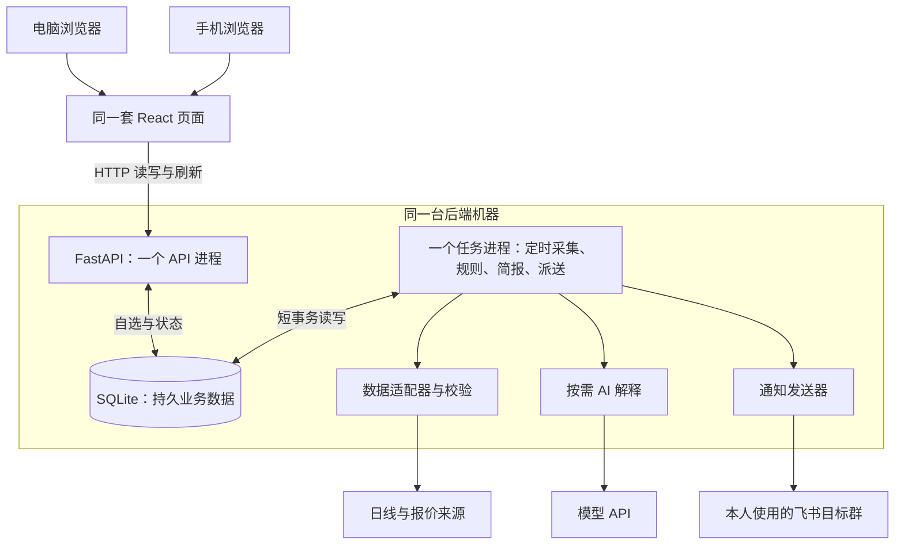

# 第五课：把各模块组合成能逐步开发的系统

调研日期：2026-10-17（北京时间）。状态：**条件性推荐，供下一步决策汇总和 PRD 使用**；应用尚未搭建。本轮完成官方资料比较、一次独立复核和一个本地存储实验。

用户本轮确认：“我自己使用，电脑和手机看同一份自选”。因此，推荐先采用 **Python/FastAPI + 后端 SQLite + React/Vite + Lightweight Charts + 单份 APScheduler 任务进程 + 飞书群机器人**。日线沿用已实验的 AKShare 路径，最新报价暂用腾讯接口，AI 通过后端按需调用。

通俗地说：两个设备打开同一套页面，向同一个后端读写自选；后台另有一个持续运行的程序，负责取数、检查异动和发送提醒。数据与执行记录保存在数据库里，页面关闭不影响后台；宿主电脑关机则会停止本地任务。

## 1. 本轮按什么条件比较

| 已确认或已有证据 | 对方案的影响 |
| --- | --- |
| 个人使用，电脑和手机看同一份自选；首页以自选列表为主 | 自选保存在后端；浏览器只能保存排序、主题等界面偏好 |
| 按课程逐步开发六个功能：自选、通知、行情、AI 解释、异动、早盘简报 | 优先让每一段流程容易观察和验证；不因课程举例增加选股引擎或交易执行 |
| 日线取数与晚间报价实验已经成功 | 可以复用字段校验和实验依据；不能据此承诺盘中实时性或所有股票可用 |
| DATA-01 盘中验证由用户明确暂缓 | 保持待办，不代替用户创建自动采样任务 |
| 这是独立的 AlphaProject-Lab | 现有生产项目只作只读参考；本组合不意味着复用生产配置、数据库或部署入口 |

仍待 PRD 明确：自选数量与市场范围、可接受的行情时效、异动规则、简报时间、通知目标与漏发处理、是否需要离家访问，以及公网写接口的权限边界。个人使用只说明使用人数，不能直接推导出“任何访客都能修改自选”；本轮也没有决定新增账号系统。

以下工作量为**排课用的粗估**：假设一个列表和详情页、一个图表、一类异动演示、一份简报和一个通知目标，由用户与 AI 协作完成代码及基本检查。按具体任务拆分估计专注小时，尚无开发计时依据；不包含学习停顿、外部授权等待与交易时段等待，PRD 定稿后重新估算。

## 2. 数据接入：先统一格式，再替换来源

“适配器”就是一个翻译层：不同网站给出的字段和单位不同，它们进入业务代码前必须变成同一种格式。

| 方案 | 优点 | 代价与边界 | 本轮判断 |
| --- | --- | --- | --- |
| AKShare 日线 + 腾讯最新报价，分别封装 | 能接上已经真实运行的实验；日线和报价各用适合的入口；可以保留来源切换记录 | 免费接口可能中断，字段与来源时间语义需要自己核验；报价暂无已验证的独立备用源 | **初版推荐**，同时保留失败和旧值状态 |
| Tushare 等有明确权限分级的数据服务 | 有文档化的数据范围和访问条件，可按需求核对权限 | 需要账户/token；日线权限不能推导出所需盘中能力；价格、配额及再展示条件还需逐项确认 | 当实测时效、覆盖或使用条件不够时重选，当前不购买 |
| efinance 等另一行情库 | 封装现成字段，部分功能可能更方便 | 本次已读的日线入口仍请求东方财富；换库不能自动解决同一上游故障 | 不作为东方财富的“独立备用源”，新增覆盖有价值时再比较 |

依据：[AKShare 股票接口](https://akshare.akfamily.xyz/data/stock/stock.html)、[Tushare 权限说明](https://tushare.pro/document/1?doc_id=108)、[上一课的源码与许可核验](03-开源项目.md)、[日线及报价实测](02-数据来源.md)。腾讯报价没有找到本轮可核实的官方完整字段契约，现有解析来自实际响应核对，长期稳定性和使用边界仍待核验。

目前日线的具体顺序是：先尝试 AKShare 的东方财富入口，失败后明确切到 AKShare 的腾讯入口；最新报价单独调用腾讯接口。日线有过真实备用切换成功，报价还没有已经验证的备用来源。

数据入口应做到：

- 日线按“股票、交易日期、复权方式、来源”区分；价格统一为元，成交量统一为股。切换来源时继续显示实际来源，不把不同复权价格直接拼起来。
- 报价分别保存来源报告时间和本机接收时间；来源时间缺失就留空并标记，不能用接收时间补成新行情。来源报告时间也不直接命名为“最后成交时间”。
- 请求失败可以展示带原时间的上次成功值；过期、时间未知或校验失败的数据，不触发新的盘中异动。休市与停牌需由相应状态证据解释。
- 每个外部请求有超时、有限重试和失败记录。当前日线实验在单线程内临时替换依赖模块的请求对象，正式服务要改成可隔离的请求适配器，重新验证并发与超时，不能原样搬入多任务后台。

为什么当前不用付费源或更多聚合库：尚未确认必须购买的能力，已有实验能支持下一步开发；增加依赖也不会自动补上时效和使用许可证据。**预计 4–8 小时**，用于拆分适配器、统一字段、记录失败和准备数据重放检查；DATA-01 的盘中观察另计。

## 3. 存储：一份后端数据库供两台设备访问

| 方案 | 优点 | 代价与边界 | 本轮判断 |
| --- | --- | --- | --- |
| 后端本机 SQLite + 可丢弃的短时缓存 | 不用另开数据库服务；支持事务、唯一约束和备份；便于学习和搬迁 | 同时只能有一个写入者；API 和任务进程要缩短写事务，不能边占着数据库边等网络 | **初版推荐** |
| PostgreSQL；有需要再加 Redis | 适合多个服务实例共享数据，数据库服务管理能力更完整 | 多出服务部署、连接和备份工作；Redis 也不能代替持久业务记录 | 实测写锁成为瓶颈或需多台后端时重选 |
| JSON 文件或仅浏览器存储 | 实验输出和界面偏好保存简单 | 服务端 JSON 可以共享，但事务、并发更新和结构升级要自行处理；只放浏览器则两台设备不会自动共享 | JSON 保留实验和导出用途，不作为业务主存储 |

SQLite 服务的是后端，不是直接给手机共享一个数据库文件。多个浏览器通过 API 访问同一个后端即可；数据库放在后端本地磁盘，不放共享网盘。[SQLite 适用场景](https://www.sqlite.org/whentouse.html)、[PostgreSQL 并发控制](https://www.postgresql.org/docs/current/mvcc-intro.html)。

初版拟保存：自选、日线、最新报价、异动及其不可变行情依据、AI 解释、简报、任务运行记录、通知发送记录。只存“最新报价”会覆盖旧内容，所以异动与 AI 结果还要保留当时采用的数据快照。业务去重不能仅存在内存。

先用 Python 自带 `sqlite3`，把 SQL 集中在存储模块，配合编号迁移与事务；页面和规则不直接拼 SQL。暂不增加 ORM 和 Redis。若实体关系与迁移明显复杂，再比较 SQLAlchemy/Alembic 的收益。进程缓存只改善读取速度，清空后必须能从数据库恢复；API 与任务程序各有内存，不能假设它们共享缓存。[FastAPI 的进程说明](https://fastapi.tiangolo.com/deployment/concepts/)。

**本轮已做存储实验。**用上一课真实保存的 600519 数据，重复写入自选和日线，主动中断一次事务，再用新 Python 进程和备份文件读取。结果见 [实验记录](../../evidence/architecture-20261017/storage-20261017T034320461969/result.json)，脚本见 [03_verify_storage.py](../../experiments/03_verify_storage.py)。

| 实验项目 | 实际结果 | 能证明的范围 |
| --- | --- | --- |
| 相同自选与 6 条日线各写两遍 | 最终 1 条自选、6 条日线 | 本实验唯一键有效 |
| 提交事务前主动抛出异常 | 未完成写入回滚 | 本实验事务边界有效 |
| 新 Python 进程读取 | 自选、报价时间、实验通知状态仍在 | 数据不只存在原进程内存 |
| 来源时间与接收时间 | 分别保留 16:14:47 与 22:02:05.400 | 存储没有把旧报价改成新报价 |
| SQLite 备份 API 生成副本后读取 | 内容检查一致，完整性检查为 ok | 这次静态样本的备份可读 |

实验环境：Python 3.12.14、SQLite 3.53.1，使用默认 `delete` 日志模式，未验证 WAL 或并发压力。首跑的 SQL 占位符数量错误已修正；复跑全部 10 个检查项通过，输入文件哈希不变。通知的 `unknown` 状态是人为设置的实验数据，**没有发送任何消息**；正常关闭后重开也不等于断电、进程崩溃恢复通过。实验表不是最终数据库结构，正式报价表须允许缺失来源时间并保留状态。

为什么现在不用 PostgreSQL：目前确认的是一个拥有者和少量并发访问，没有多机写入或写锁瓶颈证据；本地实验支持 SQLite 继续进入开发验证。**预计 3–6 小时**，用于初版表结构、存储接口、迁移和恢复检查。正式备份继续使用一致性备份方法，不依赖随意复制活跃数据库文件。[SQLite 备份 API](https://www.sqlite.org/backup.html)。

## 4. 业务逻辑：规则管触发，AI 管解释

| 后端方案 | 优点 | 代价与边界 | 本轮判断 |
| --- | --- | --- | --- |
| Python + FastAPI | 可以延续 Python 数据实验，清楚区分 API、数据、规则、模型和通知模块 | 管理后台、持久任务和权限策略需要按实际需求补齐 | **初版推荐** |
| Python + Django | 自带较完整的模型、管理后台和账户能力 | 当前个人工具不一定用得上这些能力，学习入口更多 | 管理与权限工作成为主要需求时重选 |
| TypeScript + Next/Node 后端 | 前后端语言统一，可采用完整 Web 框架 | 现有 Python 数据接入需迁移或保留另一运行环境；目前没有服务端页面渲染需求 | 用户转向 TypeScript 主线时再比较 |

依据：[FastAPI](https://fastapi.tiangolo.com/)、[Django 官方概览](https://docs.djangoproject.com/en/5.2/intro/overview/)、[Next 服务端与客户端组件](https://nextjs.org/docs/app/getting-started/server-and-client-components)。这些是适配当前项目的判断，没有做三个框架的性能比赛。

业务流程拟为：有效行情进入 → 规则按需求判断异动 → 保存事件与当时依据 → 准备基础提醒 → AI 按需补充解释。AI 超时仍能看到原始事件和依据；不得让模型补造价格或决定数据是否“新鲜”。简报也要标明使用的数据日期和生成时间。模型品牌与质量到 AI 功能课再用同一批材料验证，本轮的价格示例不等于选定模型。

定时工作有三种实现方向：

| 调度方案 | 适合什么 | 本轮取舍 |
| --- | --- | --- |
| APScheduler 稳定 3.x，单独一个任务进程 | 同一 Python 项目里执行周期采集、异动与简报 | **推荐**；API 与任务各一个启动入口，后续用统一启动脚本管理 |
| Windows 任务计划 / Linux cron | 少量固定时间的批处理脚本 | 可做离线批任务，但动态规则、运行状态和跨环境调试要自行串联 |
| Celery 等独立任务队列 | 长任务持续排队，需要多个执行者、优先级或复杂重试 | 当前无此需求证据，暂不引入队列与 broker 服务 |

任务程序只启动一份；API 重启或打开多个页面不应新建调度器。统一使用 Asia/Shanghai 时区，并依据交易日历决定市场任务是否执行；具体日历源仍待验证。固定计划可由代码重建，业务运行与冷却记录落库。若未来使用 APScheduler 持久 job store，需稳定任务 ID 和替换式注册；3.x 不支持多个调度进程直接共享同一 job store。[官方 FAQ](https://apscheduler.readthedocs.io/en/3.x/faq.html)、[用户指南](https://apscheduler.readthedocs.io/en/3.x/userguide.html)。

`max_instances=1` 等任务级设置不能防止整套程序启动两份；后续须验证宿主单实例锁或等效启动约束。错过的简报是否补跑、过时异动是否作废由业务规则决定，不默认补发所有错过任务。长 AI 调用安排独立执行槽位与超时，持续积压时再考虑队列。FastAPI 的 `BackgroundTasks` 适合响应后的工作，不承担本方案的定时和持久运行职责。[FastAPI 文档](https://fastapi.tiangolo.com/tutorial/background-tasks/)。

为什么现在不用 Django 或完整 Agent 框架：当前主要工作是已有数据、少量接口和可追溯规则，额外后台与复杂编排尚无明确收益。**预计 8–16 小时**，用于接口、一类异动规则、任务记录、模型入口及失败处理，不含新增策略或预测能力。

## 5. 前端：先把同一份数据在电脑和手机上看清楚

| 方案 | 优点 | 代价与边界 | 本轮判断 |
| --- | --- | --- | --- |
| React + TypeScript + Vite | 列表、详情和状态可以拆成小组件；后端 API 不受页面实现绑定 | 要学习组件状态、请求及手机布局；Vite 本身不提供完整业务框架 | **教学默认推荐**；与只读参考工程的方向一致，可对照理解 |
| Vue + TypeScript + Vite | 同样能实现响应式页面，模板写法更接近 HTML | 也要处理请求、布局与状态；改用 Vue 不减少数据和通知工作 | 同等可行；用户更易理解 Vue 时可替换 |
| Streamlit | 很快把 Python 数据变成可浏览的实验页面 | 精细交互布局仍需取舍；单靠会话状态不能实现跨设备持久自选和后台任务 | 适合短期实验看板，本轮优先学习完整 Web 流程 |

依据：[React 从头构建应用](https://react.dev/learn/build-a-react-app-from-scratch)、[Vite](https://vite.dev/guide/)、[Vue 快速开始](https://vuejs.org/guide/quick-start.html)、[Streamlit 状态说明](https://docs.streamlit.io/develop/api-reference/caching-and-state/st.session_state)。React 官方对一般新应用优先建议框架，也提供从头构建的教学路径；选择 Vite 是当前范围的取舍，不代表 React 普遍优于 Vue。现有本机 Node 24.15.0 满足 Vite 当前基本版本要求，但尚未构建这个练习应用。

图表优先验证 **Lightweight Charts**，先展示日线与成交量；需要更多内置指标和画线工具时再实测 KLineChart。上课前核验的发布版本分别是 5.2.1 和 10.1.0，真正安装时锁定并复查兼容性。保留上游要求的署名、NOTICE 和链接；图表库只负责画图，不提供本系统的行情数据。具体依据见 [第三份调研的版本与许可](03-开源项目.md)。

页面组件先围绕按钮、表单、自选表格和状态提示组织；完整组件库到界面阶段按需要选择，当前不引入一个大型后台模板。手机上至少要能完成添加/删除自选、查看行情时间和通知状态，具体布局随后设计。

更新方式先用 **HTTP 周期读取**：等上次请求结束再安排下一次；隐藏页面暂停或降频，回到前台重新读取；频率等待 DATA-01 和需求共同确定。网页只读后端保存的行情，不让两个设备各自重复请求外部行情源，也不以浏览器计时器负责异动提醒。[MDN 轮询注意事项](https://developer.mozilla.org/en-US/docs/Web/API/Window/setInterval)、[页面可见性](https://developer.mozilla.org/en-US/docs/Web/API/Page_Visibility_API)。

SSE 可在将来需要后端主动推送状态时比较；WebSocket 适用于确有双向持续通信的需求。现在没有这类必要证据，保持简单请求有利于逐步排查。[SSE 单向通信说明](https://developer.mozilla.org/en-US/docs/Web/API/Server-sent_events/Using_server-sent_events)。

为什么第一版不直接用 Next 全栈或 Streamlit 定型：现有数据工作在 Python，前者需协调两种后端职责；后者适合实验但不能省掉共享存储与后台任务。**预计 8–16 小时**，用于列表、详情、图表、失败状态和电脑/手机实际流程。

## 6. 通知：先接一个目标，再记录每次发送结果

| 方案 | 优点 | 代价与边界 | 本轮判断 |
| --- | --- | --- | --- |
| 飞书群自定义机器人 Webhook | 后端用 HTTP 向一个固定群发送提醒，接入范围小，可配置签名 | 限于所在群；没有本方案可依赖的消息读回与恰好一次送达保证 | **固定单群前提下推荐**，实际目标和配置待通知课确认 |
| 飞书应用机器人 + 官方 SDK | 适合应用权限、多个目标、消息管理或交互能力 | 多出应用、权限和 token 管理；仍需正确处理失败与不确定结果 | 当 Webhook 的能力确实不够时采用 |
| 邮件通知 | 已有收件邮箱时方便，适合摘要 | 邮件服务配置、到达与收件箱分类需要验证；服务器接受不等于用户看到 | 用户更常看邮件时替换或补充，本轮不并接多通道 |

依据：[飞书自定义机器人指南](https://open.feishu.cn/document/client-docs/bot-v3/add-custom-bot)及 [开源调研中的官方 SDK 源码核验](03-开源项目.md)。本轮不发送真实消息。上一课把 SDK 列为候选；本轮根据“个人、共享一份自选”的范围进一步收窄为固定单群 Webhook，仍需需求阶段确认接收方式。

通知先建一份数据库里的“待发送清单”（outbox）：先保存事件和待发记录，再在事务外调用飞书，最后保存平台结果。密钥只留后端。每次业务事件使用稳定 ID；刷新页面、重复轮询不产生新 ID。重新触发与冷却规则到 PRD 确定。

| 记录状态 | 应表示什么 |
| --- | --- |
| pending / sending | 等待发送 / 已开始尝试；启动恢复时检查遗留 sending |
| confirmed | 平台明确返回成功并已记账；不等于用户已阅读 |
| failed | 有明确失败依据；按错误种类决定能否重试 |
| unknown | 可能已经送达，但因超时或中断没有可靠结果；先保留供核对，不盲目自动重发 |

数据库唯一键能挡住已知重复，不能消除“飞书已收到、程序还没记账就中断”的窗口。换成 SDK 也不能不经验证就宣称绝不漏发、绝不重复。后续先用本地收件替身验证中断，再在授权和配置齐备时发一条带测试标识的消息，以实际目标群出现消息为接通证据。

为什么现在不用应用 SDK 或多个通道：若只是一个群单向收提醒，暂没有额外能力需求。**预计 4–8 小时**，用于模板、签名、持久状态、中断检查和一条真实送达验收；外部群与权限配置等待另计。

## 7. 部署运维与月预算

| 方案 | 优点 | 代价与边界 | 本轮判断 |
| --- | --- | --- | --- |
| 本机开发，手机同局域网访问 | 无需新增云资源，方便逐步调试 | 手机需访问电脑地址；休眠、关机和网络变化会影响任务，不能保证全天运行 | **开发阶段推荐**，跨设备流程尚未实际验证 |
| 一台常开云服务器，前后端同一网址 | 静态页面、API、单份任务程序与本地 SQLite 的关系清楚；不依赖个人电脑开机 | 需要 HTTPS、备份、进程管理、更新回滚和明确的访问权限 | **持续运行阶段优先比较**，规格、价格和平台到部署课确认 |
| Serverless 函数 + 外部持久存储 + 定时触发 | 可按需运行，平台提供弹性与定时入口 | 要重新安排持久存储、实例生命周期、定时和状态；不能依赖临时磁盘长期保存 SQLite | 低频独立任务或平台需求明确时再选 |

Serverless 并非不能定时，也不是必然更便宜：阿里云提供 [定时触发器](https://help.aliyun.com/zh/functioncompute/time-triggers)和 [持久/临时存储选型](https://help.aliyun.com/zh/functioncompute/selection-of-function-storage)，具体价格按 [资源用量](https://help.aliyun.com/zh/functioncompute/billing-overview-of-fc)计算。当前两进程与本地数据库的组合在单机更容易观察，暂不为它改造存储。

后续单机部署拟用构建后的前端静态文件、一个 API 进程和一个任务进程；它们来自同一工程，通过同一份数据库配合。前端构建需要 Node，静态成品不要求再启动 Node 业务服务。代码、运行数据和秘密配置分离，更新前做兼容性及备份检查；回退代码不覆盖上线后新数据。当前未选择生产主机，未执行部署。

**月预算先拆项，不编造总价。**本地开发没有新增云主机费，不计现有设备、电费和网络；AI 按实际调用另计。云端总额暂记为 `服务器实际报价 S + AI 用量费 + 数据授权费 + 未含在套餐内的备份/域名/流量等费用`。

给一个可复算的 AI 例子，仅用于预算：2026-10-17 查到 DeepSeek `deepseek-flash` 高峰、缓存未命中输入为 2 元/百万 token，输出为 8 元/百万 token。假设 30 天每天 20 次解释，每次输入 3000、全部计费输出 1000 token；另每天一份简报，输入 8000、全部计费输出 2000 token。全部按上述单价算：[官方价格](https://api-docs.deepseek.com/zh-cn/quick_start/pricing/)。

| 示例项 | 计算 | 月费用 |
| --- | --- | --- |
| AI 解释 | 30 × 20 × (3000 × 2 + 1000 × 8) ÷ 1,000,000 | 8.40 元 |
| 简报 | 30 × (8000 × 2 + 2000 × 8) ÷ 1,000,000 | 0.96 元 |
| 示例 token 合计 | 8.40 + 0.96 | **9.36 元** |

这不是实测账单、预算上限或系统总月费；真实输出、思考 token、重试和搜索抓取可能改变费用，示例也未决定每天必须调用 20 次。AI 不随页面刷新反复调用，实施时要设置用量记录与预算上限。云服务器尚未选地域、规格和计费周期；阿里云文档明确示例价格不代表实际购买价，因此 S 保持待报价。[官方计费说明](https://help.aliyun.com/zh/simple-application-server/product-overview/billable-items)。

为什么现在不直接买服务器或迁到 Serverless：需要先完成本地功能和实际资源观察，且新工程宿主尚未确定。**预计 4–8 小时**，用于确定宿主后配置进程、部署、备份恢复和公网复验；采购与外部审核等待另计。

按上述拆分，六模块排课估算为 **31–62 个专注小时**，再预留 **6–12 小时**做跨模块联调，即约 **37–74 小时**。这是当前简化范围的规划区间，不是交付承诺；新增账户、更多行情、复杂策略等需另估。

## 8. 推荐组合怎样连接

下图是拟实施方向，所有连线都还不是应用联调通过的证据。

同一条用户流程可以逐步验收：

1. 电脑添加自选 → API 写入数据库 → 手机刷新后读到同一条；刷新或 API 重启不会抹掉自选。
2. 任务程序读取自选 → 请求行情并校验 → 保存最新值及来源时间；网页读取这个结果，不重复向行情源取数。
3. 有效且适用于当前时段的数据满足规则 → 保存异动与当时依据 → 保存待发送记录；AI 作为可失败的补充。
4. 发送器调用通知通道 → 记录明确成功、失败或未知；网页和消息使用同一个事件 ID，便于核对。

统一数据边界的拟议最小字段：报价包含市场代码、价格、单位、来源、来源报告时间、接收时间和质量状态；日线再带交易日期与复权方式；异动包含规则版本、事件 ID 和依据快照；AI 结果包含输入快照、模型标识、生成时间与失败状态；通知包含目标引用、事件 ID、尝试及平台结果。最终字段与阈值到 PRD/架构阶段细化，秘密值不返回页面。

## 9. 独立复核改变了哪些取舍

按架构评审 Skill 的标准模式，安排一名独立上下文复核者，使用原始实验、源码与官方资料；首轮未提供主分析者的推荐。完整记录见 [独立复核](../../evidence/architecture-20261017/independent-review.md)。

| 论点 | 证据与质疑 | 本轮处理 |
| --- | --- | --- |
| C1 两台设备可以用 SQLite | 共享的是后端 API，不是浏览器数据库；本地实验尚未跨设备 | 采用后端 SQLite，保留双设备验收，不宣称已经同步成功 |
| C2 任务不能跟页面数量一起增加 | API 内启动调度器会与重载、多 worker 形成耦合 | 推荐 API 与单份任务进程分开，后续验证单实例约束；接受多管理一个入口的代价 |
| C3 进程缓存不能充当共享状态 | 不同进程内存独立；重启会清空去重记录 | 最新共享报价和业务状态落库，各自缓存可丢弃 |
| C4 数据库去重不等于通知恰好送达一次 | 远端收到、本地未记账的中断窗口仍存在 | 增加明确的 unknown 处理与后续中断验证，不以 SDK 或成功次数作保证 |
| C5 实验代码不能全部直接复用 | 日线实验临时替换模块请求对象，只在单线程里验证过 | 复用语义和测试样例，重做正式网络边界；模型调用也不占用行情任务执行槽位 |

## 10. 已完成、待验证与下一步

已完成的是模块资料比较、独立复核，以及本地 SQLite 的重复写入、事务、重新读取与备份实验。没有安装候选应用、调用付费模型、发送通知或部署练习系统。旁边生产代码的只读核对用于理解结构，不作为新工程已具备功能的证据。

| 后续验证 | 通过标准 | 不通过时怎么办 |
| --- | --- | --- |
| DATA-01 盘中行情 | 确认交易时段与股票状态，观察来源时间及价格变化，记录失败与时效 | 修正数据语义或重选来源；不把晚间成功改记为实时通过 |
| 两设备与重启 | 手机/电脑访问同一后端，自选一致，API 重启后保留，写权限符合已确定规则 | 先修接口、持久层或权限；不因设备多就盲目升级数据库 |
| 定时与通知中断 | 第二份任务程序被阻止；同一事件不因刷新重发；不确定发送保留 unknown | 修任务归属、事件与状态；若接受自动补发，明确重复的取舍 |
| 真正送达 | 配置与授权齐备后，一条测试事件实际出现在目标群，与页面记录一致 | 按平台结果和收件证据排查；仅 HTTP 成功不作为接通结论 |
| 模型失败与预算 | 超时仍保留行情与基础事件，不补造缺失事实；调用量可查、预算限制有效 | 修提示词、输入依据或调用控制，必要时换模型 |

重选路线保持可撤回：数据源换适配器；SQLite 在实测写入瓶颈或多机需求出现后迁 PostgreSQL；前端和图表通过 API 替换；通知在需要交互、多目标时换应用接口；长任务持续积压再加队列。迁移前保留字段、数据与恢复验证，不能只替换依赖名称。

**下一课：**把 01–04 的结论整理进 `05-决策汇总.md`，区分用户已确认、条件性推荐与待办，再进入 PRD。当前仍处于课程调研阶段，这份实现方向不提前冒充最终架构。

实际执行方式：标准模式，独立上下文复核一名；本地存储实验通过，盘中行情、跨设备 API、通知和完整应用仍待验证。本轮没有要求用户完成术语问答，也没有将助手实测记作用户已独立掌握。
