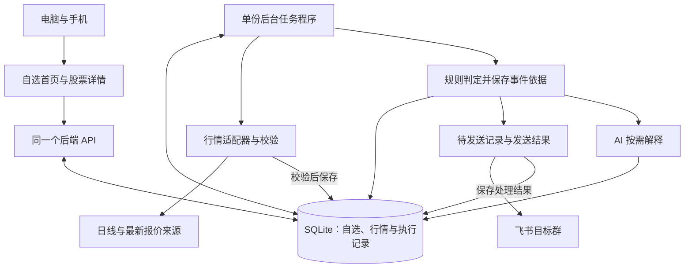

# 第六课：当前决策汇总

整理日期：2026-10-17（北京时间）。范围：AlphaProject-Lab。本文汇总 01–04，不把调研结论写成已上线功能；此后改变选择时，在本表记录原因，前四份调研保留其当时证据。

**目前的方向：个人使用，以自选列表为首页，电脑和手机访问同一个后端。拟采用 FastAPI + SQLite + React/Vite + Lightweight Charts + 单份 APScheduler 任务进程 + 飞书群 Webhook。已跑通的是日线、晚间报价与本地存储实验；应用页面、跨设备、定时和通知还没有接通。**

## 1. 先分清“决定”和“验证”

“已确认”表示用户已明确选择或项目约定已经确定；“拟采用”表示有依据的当前推荐，可以据此准备 PRD 和小规模实现；“待决定”表示缺少会影响行为的信息。它们都不等同于“功能已完成”。

验证另记为资料说明、源码检查、最小实验或真实端到端。一个方案可以已经选好，却还没有实际运行；一个实验可以成功，却不足以定为最终方案。

## 2. 已确认的产品和学习边界

| 编号 | 已确认内容 | 依据 | 对后续工作的影响 |
| --- | --- | --- | --- |
| D-01 | 从空练习工程按课堂主线逐步开发，通过实践学习 | 2026-10-16 用户要求；[项目约定](../../AGENTS.md) | 每轮推进一个可检查任务，保留必要的需求、设计、工程准备与验收 |
| D-02 | 首页以自选列表为主 | 2026-10-16 用户选择 A；[01-产品形态](01-产品形态.md) | 先找到关注的股票，再展开行情、变化和解释；其他页面细节未定 |
| D-03 | 个人使用，电脑和手机看同一份自选 | 2026-10-17 用户明确回复 | 自选放后端共享存储；不依赖各设备各存一份浏览器数据 |
| D-04 | 沿用六个功能：自选、通知、行情、AI 解释、异动、早盘简报 | 已沿用的课堂范围与项目约定 | 详细功能和顺序按依赖在 PRD 中细化；暂不增加交易、预测或全市场选股 |
| D-05 | DATA-01 盘中验证先记待办，继续课程 | 2026-10-16 用户要求；[02-数据来源](02-数据来源.md) | 保持待验证，不创建自动采样或提醒任务，不把晚间请求成功当实时性通过 |
| D-06 | Lab 与现有生产应用、课程原件独立 | 项目约定 | 本工程的代码、配置、数据和部署另行管理；生产持续发布规则不覆盖 Lab |

以下技术组合是当前推荐，**不是用户逐项口头确认的事实**；本轮整理不会新增一次形式审批。关键偏好在写相关需求时问清，非阻塞未知不妨碍继续准备。

## 3. 六模块的当前推荐

| 模块 | 拟采用的方案 | 为什么适合当前范围 | 验证状态与重选条件 |
| --- | --- | --- | --- |
| 数据 | 日线用 AKShare：东方财富主尝试，失败后明确切腾讯；最新报价单独用腾讯接口 | 已有真实取数和备用切换记录，便于继续实验 | 日线和晚间单股报价为最小实验；盘中、日历、限频与使用条件待核验。报价尚无已验证备用源 |
| 存储 | 后端本地 SQLite，先用 sqlite3；各进程缓存可丢弃 | 一份共享自选、少量写入，不增加数据库服务 | 本地唯一约束、事务和重新读取通过；双设备、并发和崩溃恢复待验。出现实测写锁瓶颈或多机写入再比较 PostgreSQL |
| 业务 | Python/FastAPI；规则判断异动，AI 解释已有依据；API 与单份任务程序分开 | 延续 Python 实验，页面操作和后台任务职责清楚 | 尚未搭建应用。稳定事件 ID、超时、预算与单实例约束要实际验证；长任务持续排队后再考虑队列 |
| 前端 | React/TypeScript/Vite；Lightweight Charts 优先，KLineChart 备选；先 HTTP 周期读取 | 先做好自选、详情和状态；图表接自己的数据 | 仅文档和源码比较，未安装/运行。Vue 同样可行；更多绘图需求或实测不合适时换图表 |
| 通知 | 固定单群前提下用飞书 Webhook；事件和发送结果持久化 | 当前不需要多目标应用管理就可先做单向提醒 | 实际通道、目标群及配置待确认，未发送消息。需要交互或多目标管理时再选应用 SDK |
| 部署 | 本机开发及局域网联调；持续运行阶段优先比较一台常开服务器 | 易观察页面、API、任务和数据库怎样配合 | 未部署 Lab，未选主机/规格。电脑关机不能继续本地任务；公网写权限和恢复流程需先明确 |

详细候选、代价与来源见 [04-实现方案](04-实现方案.md)。React、SQLite 或 Webhook 都不是不可更换的结论；现阶段也不引入 Redis、多智能体平台或完整交易框架。

数据的必要约定：价格和成交量统一单位；日线保留复权方式；报价分开保存来源时间和接收时间；缺失/失败不填成零或“现在”。旧值可以带原时间展示，但不能冒充新行情触发盘中提醒。当前实验中临时替换依赖请求对象的做法，只在单线程内验证过，正式服务应重做网络边界。

任务只运行一份，不随浏览器数量或 API 重启增加。AI 的慢请求和失败不能阻塞行情与基础事件。通知先保存待发记录，再调用平台；明确成功、明确失败与结果未知分别处理，不能承诺未经验证的绝不漏发、绝不重复。

## 4. 开源资产怎么用

| 方式 | 当前选择 | 取用边界 |
| --- | --- | --- |
| 采用正式组件的方向 | AKShare、FastAPI、APScheduler 稳定 3.x、React/Vite、图表库 | 工程准备时建立 Lab 自己的环境、锁定版本并验证；目前只有已有解释器支撑的小实验，不代表新工程依赖已装好 |
| 借鉴流程，按需要再考虑小模块 | daily_stock_analysis 的来源失败处理、分析/报告组织、通知决策与评测方法 | 明确所选文件的依赖和许可；其已查通知去重有进程内状态，不能直接满足重启恢复 |
| 借鉴页面与提醒组织 | OpenStock、StockWatch | 不整仓复制；OpenStock 已查快照的市场、身份和存储假设不等同本工程 |
| 新增方法参考，尚非依赖 | Promptfoo 的固定用例与断言式评测 | 先把 AI 用例和标准写清；需要自动比较时再决定是否接工具。本轮没有安装或运行它 |
| 暂不采用 | 完整 TradingAgents、Qlib、vn.py、Backtrader 等 | 当前没有多智能体、预测训练、交易执行或回测的验收目标，保留后续重选入口 |

项目版本、许可、源码依据以 [03-开源项目](03-开源项目.md) 的快照为准；本轮新增的评测参考见 [课堂路线改进建议](../learning/课堂路线改进建议.md)。不是看到现成能力就自动增加功能。

## 5. 现在究竟验证到哪一步

本轮回读并核对以前的记录，没有重跑行情、数据库或模型实验。

| 实验 | 可确认的结果 | 不能推出的结论 | 直接证据 |
| --- | --- | --- | --- |
| 2026-10-16 日线 | 600519 指定日期范围取得 6 条日线；一次首选失败后腾讯成功；两份成功来源记录的六行数据一致 | 全部股票、同一瞬间一致性、长期稳定；000001 没完成跨来源对照 | [日线核验](../../evidence/data-source/verification-20261016T211809.json) |
| 2026-10-16 晚间报价 | 两次取得 600519 报价并保留来源时间；接收时间变化，来源时间均为 16:14:47 | 盘中持续更新、市场端到终端延迟、来源时间就是最后成交时间 | [报价核验](../../evidence/data-source/spot-verification-20261016T220600.json) |
| 2026-10-17 本地 SQLite | 重复写入后保留 1 条自选与 6 条日线；事务回滚、新进程读取和备份可读，10 项检查通过 | 手机同步、并发压力、断电/进程崩溃恢复、真实通知送达 | [存储实验](../../evidence/architecture-20261017/storage-20261017T034320461969/result.json) |

存储实验的通知状态是人为设置的测试记录，不是飞书回执。页面、模型、调度器和通知仍是待实现的连接。

## 6. 拟实施的完整路径

下图表示目标设计，尚未进行整条应用流程验收。

首先验“电脑添加 → 后端保存 → 手机读取 → API 重启仍保留”；再验“任务读取自选 → 采集和判断 → 保存同一事件 → 发送 → 目标群与页面能对上”。每条路径首次具备执行条件就检查，不等整个项目做完才发现接缝断开。

## 7. 待验证项及完成标准

| 编号 | 缺口与当前状态 | 怎样才算补上 | 何时影响继续工作 |
| --- | --- | --- | --- |
| DATA-01 | 盘中更新；用户已暂缓 | 已确认交易时段的真实响应，检查日期/时间变化、股票状态与失败，按已约定时效判断 | 不阻碍写 PRD 和自选开发；未通过前不宣称实时盯盘可用 |
| DATA-02 | 覆盖、日历、停牌、单位、限频和数据使用条件未完整核验 | 明确首版市场/证券范围，验证代表性代码与边界；记录提供方条件和缺口 | 接入相应数据用途或公开展示前解决对应缺口 |
| FLOW-01 | 双设备与持久化尚未联调 | 两端访问同一后端，增删一致；刷新和 API 重启不丢；手机实际操作与桌面模拟分报 | 第一个自选功能的实际验收 |
| JOB-01 | 单份任务与恢复待验 | 第二份任务实例被阻止；重启保留运行/冷却状态；错过任务按规则处理 | 开启持续采集、异动和简报前 |
| PUSH-01 | 通道、目标与真实送达未接通 | 明确接收目标；先测失败和中断，再经授权发一条测试消息，实际目标收到且记录一致 | 不能用本地待发记录或 HTTP 成功替代通知接通 |
| AI-01 | 模型、提示词、内容质量与预算未验 | 固定输入下比较事实支持、引用、缺数据表现、成本和耗时；超时不阻断基础业务 | AI 解释/简报进入可用状态前；具体评测建议见配套文件 |
| UI-01 | 页面和手机体验尚未实现 | 真实完成添加/删除、看时间/失败、打开图表；实际设备范围写清 | 对应页面交付时 |
| OPS-01 | Lab 宿主、访问边界与发布恢复未定 | 确定平台和配置，验证 HTTPS、版本、备份恢复及更新后数据保留，再从目标入口复验 | 公开部署和全天运行前 |

这些是下一阶段的工作清单，不是今天已经执行的测试。只有与当前切片相关的缺口才约束该切片，不要求先解决全部事项才动手。

## 8. 需要在 PRD 中确定的行为

- 个人使用的访问方式：只在局域网，还是离家也访问；公网时谁能修改自选和通知设置。不能从“个人用”直接推出任意访客可写，也不擅自增加账户系统。
- 首版关注的证券范围与规模、行情过期标准、停牌/休市时怎么显示；这些值现在留待确认，不虚构实时性指标。
- 异动先做哪一类、比较基准、冷却和再次触发条件；通知是否接受未知状态核对或自动补发可能重复的取舍。
- 通知渠道与接收目标、简报时间和漏过时间后的处理；飞书群 Webhook 当前只是条件性推荐。
- AI 应回答什么、缺资料时如何表达、预算上限；模型名称和新闻来源尚未定案。

能提出建议值，但必须注明是建议，不能写成用户已经给出的要求。

## 9. 预算与风险

沿用 [04 的费用示例](04-实现方案.md)：按 2026-10-17 查到的 `deepseek-flash` 高峰、缓存未命中输入 2 元/百万 token、输出 8 元/百万 token；假设 30 天每天 20 次解释（每次 3000 输入、1000 全部计费输出），另每天一份简报（8000 输入、2000 全部计费输出），token 示例费用为 **8.40 + 0.96 = 9.36 元/月**。[价格依据](https://api-docs.deepseek.com/zh-cn/quick_start/pricing/)

这不是模型决定、系统总价、费用上限或实测账单；不同用量、重试、思考与搜索抓取会改变费用。总额仍为 **主机实际报价 S + AI 实际用量 + 数据授权及套餐未含费用**。本机开发没有新增云主机费，现有设备、电费和网络未计入；S、数据费用、预算上限待确定，未采购资源。04 中的 37–74 专注小时仅为原简化范围排课估算，新增评测和故障演练尚未另估。

最需要控制的风险及处理方向：旧行情配新时间会误导判断，因此来源时间贯穿展示和规则；通知中断会产生未知结果，因此持久记录并先核对副作用；AI 可能补造原因，因此保留证据并评测缺资料表现；文档和测试总数可能掩盖断链，因此按真实用户路径确认最终结果。它们都是待实现、待验证的要求，不能由本文存在就声称已经解决。

## 10. 下一步

进入精简 PRD：先明确六个功能的范围、核心路径、必要失败状态与验收；把上述关键缺口放到相关功能里确定。随后为第一个“自选保存并跨设备读取”的切片完成必要架构、界面和工程准备，再让用户实际操作。

对课程深度与改法的判断另存于 [课堂路线改进建议](../learning/课堂路线改进建议.md)。其中新增质量目标与进阶路线是本轮建议，不直接改写为用户已确认的产品范围。

本轮采用已有证据的轻量复核；沿用 04 的独立评审，不重做整套选型或新开代理辩论。完成的是决策汇总与路线建议，PRD、应用实现和上线尚未开始。
